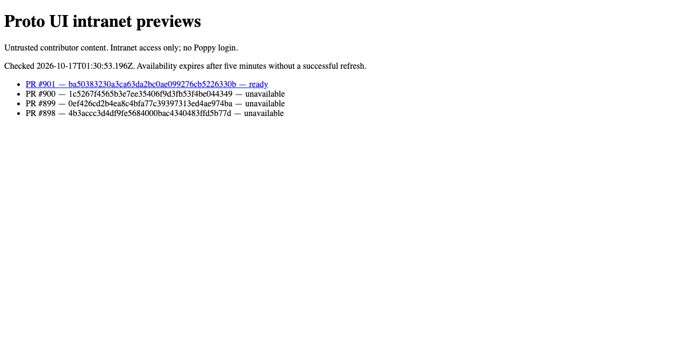
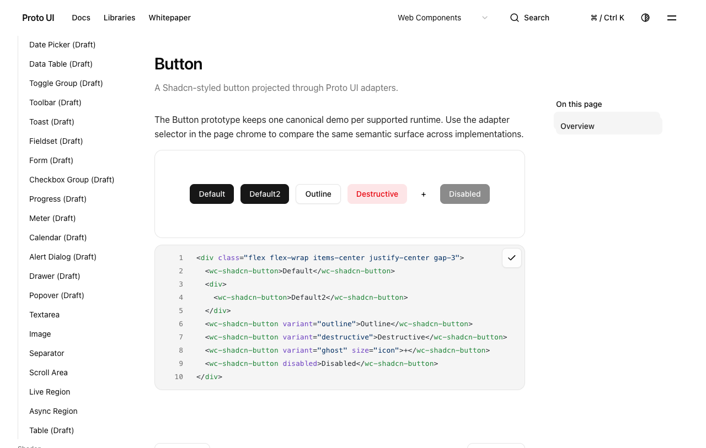
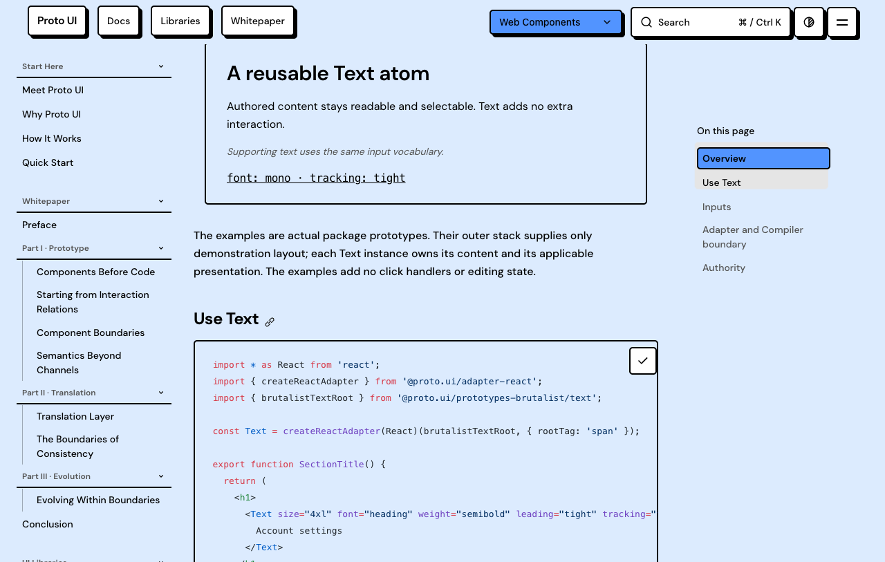

# Complete documentation preview admission — ba503832

Agent paraphrase of [the maintainer QA](https://github.com/Proto-UI/Proto-UI/pull/888#issuecomment-6219356099): reconcile the complete generated documentation artifact with the existing preview admission contract, retain intended pages/assets, and provide actual artifact/catalog/page evidence. This package accompanies [PR #901](https://github.com/Proto-UI/Proto-UI/pull/901), exact head `ba50383230a3ca63da2bc0ae099276cb5226330b`, based on main `404a7417ef8dc22c8c7fe6d9ff9f3c8a5d40a17b`.

## Executed stages

| Stage | Observed result | Evidence boundary |
| --- | --- | --- |
| Original #888 artifact 12021500228 | Actual default entry listing rejects expanded size above 104,857,600 bytes | Original be8 artifact; not relabeled as a new build |
| Current-main complete local build | 118,083,099 expanded bytes; the complete artifact test fails for the original size bound | Node 24.21.0 / pnpm 10.32.1, macOS arm64 |
| Preview candidate complete local build | 3,836 files / 104,047,224 expanded bytes; complete ZIP/source/extract/sanitize equality passes | Same production build; original safety limits remain |
| Official exact-head build 38990834138 / job 117272659039 | Complete regression 1 PASS: 3,835 files / 104,045,005 expanded bytes | Linux / Node 24.21.0 / pnpm 10.32.1; local/CI counts and ZIP bytes are distinct |
| GitHub artifact 12085151166 | 21,143,347 compressed bytes; SHA256 a77dc8d0f3ba20806460e84d5c642753b0f8036184e285059a3e68ea1d3c66a4 matches metadata | Independent retained download was a second read after the publisher consumed the first; no Actions rerun |
| Existing actual publisher, live GitHub APIs | PR/head/run/attempt/artifact admitted as Ready; all 3,835 sanitized files equal retained ZIP members by SHA256 | Output and server are local; no remote deployment/configuration change |
| Actual GitHub-backed catalog/pages | Native catalog navigation; Shadcn four runtime interactions and Brutalist Text four CopyControl runtime interactions; real clipboard equals complete source | Runtime preference is test input; no runtime-menu-selection, four code-generator or universal Adapter claim |
| Serving guards | Unrefreshed catalog returns 503 after 329.288229 seconds; independent worker guard returns 403 | Actual local server; not a remote service acceptance claim |
| Dialog fixture | Original selected case red; actual Mask exists in the legal Adapter-owned container; one-line descendant lookup green (1 pass / 7 filtered) | Geometry, inputs, eight case definitions and original deadlines unchanged; no production Overlay fix claimed |

## Content and rendering preservation

All 669 HTML paths, code payloads, 2,407 script chunk identities, 5,406 module records and Pagefind's 635 document URLs/content were reconciled independently. Local resource references add no missing assets. The same deliberate missing-image fixture and existing navigation gaps remain visible. Exact rule contents/conditions remain; Astro's extraction reorders rules on 636 pages, so this is not a claim of globally identical CSS order or universal paint equivalence. Four no-JavaScript baseline/candidate pairs have identical sampled style facts and PNG bytes. The successful observations occur in a run that later failed a private readiness probe; that later failure remains in the archive.

## Actual figures

The real catalog binds #901 to exact ba503832 and run 38990834138. This is a locally executed existing publisher/server, not a hand-authored Ready row and not proof of the remote intranet deployment.

These are original compositor captures after real native clicks and clipboard checks. Other runtime captures and no-JavaScript comparisons are included under `images/`; observation JSON carries actual requested viewport and runtime. Captured pixel dimensions are retained separately. Initial preference selection, source-code rendering and CopyControl runtime are separate observations.

## Validation and retained failures

Existing preview suite: 61 pass, one explicit generated-artifact skip without build inputs. The actual complete artifact check separately passes with all inputs. Types: 934 Astro files, zero errors/warnings, 14 hints. A focused source group retains 42 pass / one unchanged site-library-family assertion failure. Private native probes include a nonexistent route, wrong readiness selectors, and attempting CodePanel interaction on a page without one; corrected controls are separate, and these errors are not production defects. Official Dialog matched-evidence run 38990834145 stopped before browser execution because the old calibrated probe hash no longer matches the corrected selector; that downstream calibration remains pending fresh evidence/review. Original portal-direction framework reopen failures and subsequent C work remain outside this exact-head preview package; no all-main CI success or #883/#612 completion is claimed.

Evidence disposition: **partial**. Existing remote intranet URL/reachability/generation remains unverified. This is not independent GitHub approval, release, general accessibility/AT evidence, or all-browser/installed-package acceptance. The publisher's native fcntl lock was held by an inline tool parameter; its original wrapper was not a pre-saved file. Receipt/CLI/output provenance is stated rather than retroactively inventing such a file.

## Reproduction and provenance

Use the committed repository's canonical `pnpm --filter apps-www build`, then the workflow's complete ZIP command and `generated-artifact.test.mjs` with both actual inputs. The real publisher/server interfaces and bounds are documented in `scripts/preview/README.md`. Use an existing appropriate read identity; no credential material is included here.

`observations.tar.gz` retains explicitly selected logs, source-bound reports, observations, private-probe derivatives and figures, including failures and controls. `raw-public-map.json` maps every original private SHA256 to the public derivative SHA256. Public helper copies are privacy-redacted derivatives: they are not claimed to be original executed bytes or runnable without path adaptation. PNGs are unmodified. The complete original GitHub ZIP is retained privately and in the run-bound official artifact (authentication/retention apply), rather than publishing its absolute runner paths in this package. The evidence-only branch must never merge into the product.
