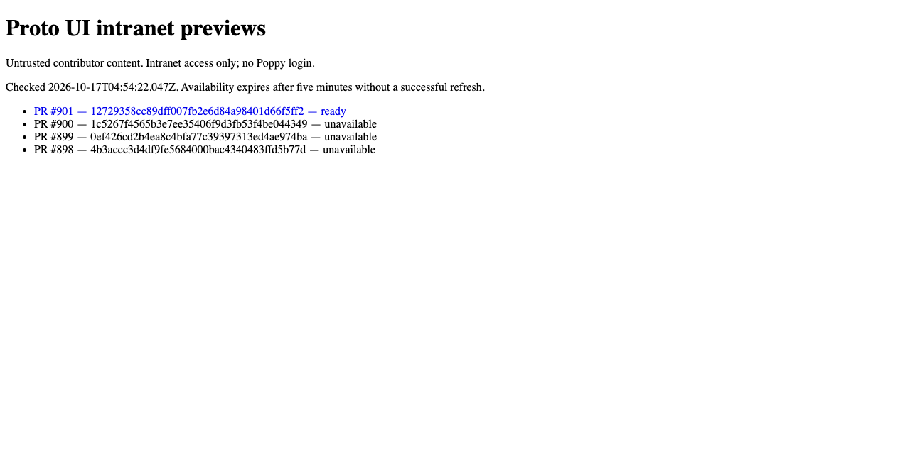
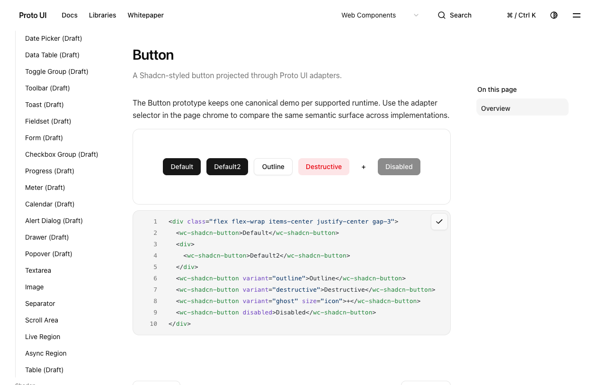
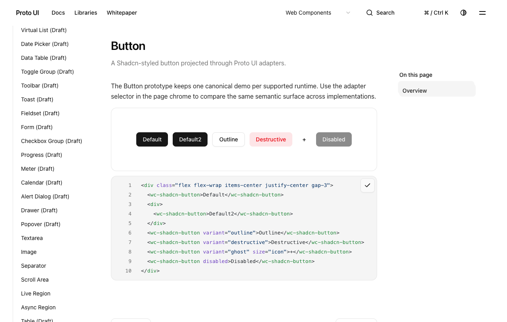
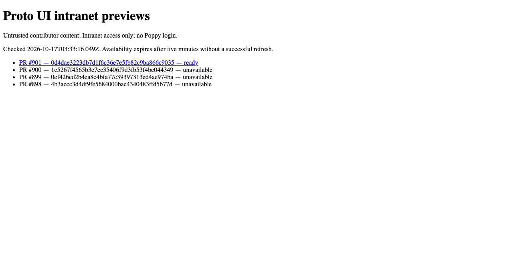
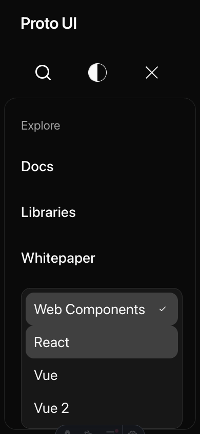

# Documentation-preview QA and C lifecycle repairs — final follow-up

This package follows the maintainer's [exact #888 QA finding](https://github.com/Proto-UI/Proto-UI/pull/888#issuecomment-6219356099): retain the complete documentation site and the original preview safety bounds, add the real producer/admission regression, show actual catalog/page evidence, and repair established C failures. [PR #901](https://github.com/Proto-UI/Proto-UI/pull/901) binds final head `12729358cc89dff007fb2e6d84a98401d66f5ff2`, tree `9788c9eb76cf486a6213d7b599738c678a374576`, over accepted main `404a7417ef8dc22c8c7fe6d9ff9f3c8a5d40a17b`. Final source bindings enumerate every changed path. Earlier runs retain their real heads/times and dirty-candidate bounds.

## Complete artifact and actual serving

Official final127 [run39004156560](https://github.com/Proto-UI/Proto-UI/actions/runs/39004156560), job117313068777, directly checks out127 and passes the complete real regression: **3,835files/104,045,299expanded bytes**,812,301 below the unchanged100MiB envelope; regressionZIP21,207,044bytes. Actual[artifact12090571095](https://github.com/Proto-UI/Proto-UI/actions/runs/39004156560/artifacts/12090571095) is21,140,949bytes, SHA256`3c2cdc065dbf790f35f2297cf43fc6b86b13e28f92126fd6c05260a646ca3e14`. Containers are distinct, not equalZIP-byte claims. Realpublisher at04:54 admits exactReady generation`p901-r39004156560-a1`; every3,835 sanitizedmember equals a separately downloaded originalZIP member SHA. Actual04:56:33–43 catalog/nativeShadcn4/Brutalist4clipboard rows pass,9neworiginalPNG individuallyviewed, serverexit0. All669HTMLroute names remain. Runtimeprefs are not runtime-menu clicks; Brutalistexample remainsReactcode.

The original complete main-source local artifact is118,083,099 expanded bytes and fails the existing100MiB envelope. Generated styles now share assets through the original generators; no intended route/resource is cut and no archive limit is raised. The CI regression consumes the complete generated build, performs bounded ZIP extraction/sanitization, and compares every resulting file byte. Earlier route/code/chunk/module/Pagefind preservation and no-JavaScript checks remain in the [published first-stage evidence](https://github.com/HyacinthHaru/Proto-UI/tree/d00d0d1f90db291791334f38ca8a0ea3e42be3df/evidence/2026-10-17/preview-admission-ba503832). Astro does reorder some CSS during extraction; this is not a universal paint/order-equivalence claim.

Official EF checkpoint [build39002392499](https://github.com/Proto-UI/Proto-UI/actions/runs/39002392499), job117307876531, passes the actual complete regression: **3,836 files/104,046,243 expanded bytes**,811,357 below the unchanged100MiB bound; its test ZIP is21,210,163 bytes. [Artifact12089661524](https://github.com/Proto-UI/Proto-UI/actions/runs/39002392499/artifacts/12089661524) is21,143,393 bytes, SHA256`3ca5c155626eb9a3da9545489ea35f6930508fb056558b73a12782a0e5fd78e4`. These are distinct ZIP containers. The actual existing publisher admits exact generation`p901-r39002392499-a1`; all3,836 sanitized files equal the independently retained artifact members. All669 HTML route names equal the0d4 stage. EF and0d4 hashed chunk/Pagefind names and whole ZIPs are not claimed byte-identical, and the earlier3,835 count is not reused as the EF count. EF actual catalog navigation and eight native source/copy clipboard checks pass at04:27–04:28UTC; all nine new PNGs are individually viewed. New server is stopped with exit0, no lease refresh or state fabrication. Exact driver URL/artifact bindings were prepared before execution. The Brutalist observation description still retained a stale short`/0d4` label; its original bytes remain, and `final-ef-brutalist-source-correction.json` additively binds the actualEF URL/publisher/run rather than rewriting that raw label.

The separate exact0d4 official artifact has3,835 files/104,045,284 expanded bytes,812,316 below the unchanged104,857,600 bound. Its actual GitHub ZIP is21,144,307 bytes with SHA2565662f54702d52416cb7d49dc97df50266852b85b059e117f04feb901c6fa2aba; the regression test's different ZIP container is21,210,354 bytes. The actual existing publisher independently uses live GitHub identity, admits generationp901-r38998718079-a1, and all3,835 sanitized files match a separately retained download's members. Real catalog navigation, four Shadcn source/copy runtimes and four Brutalist Text CopyControl runtimes pass with actual clipboard contents. Nine new0d4 PNGs are inspected. Brutalist's example remains React code; runtime preferences are not runtime-menu clicks.

All such publisher/server runs are **local against real GitHub metadata/artifacts**. The existing remote intranet URL/reachability/generation remains unverified. No remote deployment, service, permission, secret or lease is changed. The earlier actual329-second catalog expiry503 and worker refusal403 remain old-stage results, not new executions.

## Established C repairs and regressions

Select view retirement now clears normal settlement/cache and advances its request epoch while retaining three blocked-recovery phases. Five controller lines change; Root open/selection, global Context policy and Adapters do not. Formal same React baseline1fail/3filtered becomes4pass with declared HappyDOM geometry. An unconditional reset's two original WC recovery failures remain as a rejected candidate. Original eight portal cases pass on the bound candidate.

The narrow-dark200% Runtime Select also exposed a distinct actual Host defect: entering paint-scale floating BCR was mixed with layout facts, inset drift exhausted the unchanged four-pass verifier and Content failed closed with `select.geometry.invalid-geometry` while Root stayed open. Floating inline facts now use CSSOM offsets/offsetWidth at the Frame origin and retain signed physical ancestor scrollLeft. CSSOM floating dimensions have **integer precision**; reference/value/Frame BCR fractions remain. Pure formulas, <0.01 plan-stability threshold, current/lease checks and fail-closed behavior are unchanged; no <0.01px final paint claim is made. Draft measurement-source text is explicit and mappings remain needs-review. Old-provider formal9pass/2fail, initial candidate11pass, signed-scroll control old2pass/candidate2fail, repaired related group58pass are all retained. The Runtime fake-layout input receives equivalent facts with expected180 unchanged, and old-provider control4pass.

Native RuntimeMask6, portal8 and target/group12 pass on frozen d28+8 candidate files. Original Homepage5 passes after its current Shadcn inventory/no-displacement recipe and strict option-visible prerequisite are reconciled. That prerequisite adds up to10s after the original portal wait; serial readiness can be about20s plus click, with original case deadlines unchanged. Initial Homepage2pass/3fail remains. Types934/0errors/0warnings/14hints and authoring/projection/doc checks pass on that bound stage. Clean0d4 postcommit native Runtime popup and React selection pass; actual BCR315.4375 and offsetWidth315 remain distinct. The final main demo is obscured by the compact Header; saved DOM establishes readiness separately.

Final broadened Select verification on96 reveals two remaining composition fixtures missing offset facts:363pass/2fail/2existingTODO. Each fixture receives15 lines matching its original declared BCR; all scenarios, expected180, assertions and timeouts remain byte-identical. Current Host focused43pass, same final fixture bytes with a privately loaded original Host43pass, and the actual expanded candidate27files/365pass/2TODO are separate executed results. The override is one original Host module in the current worktree, not an entire historical checkout. No new production change follows0d4.

## Final RadioGroup recipe-oracle repair

The EF shard5 original cause atline324 is expectedlight checkedalpha0/actual1. Its preceding native selection leaves Default checked. Current draft `P-SHADCN-RADIO-GROUP-ITEM-CURRENT-VISUAL-SURFACE` explicitly requires checked primary fill in both themes; applicable Shadcn T agrees, and Base T does not own visuals. The final test corrects checked Default toalpha1 and separately checks unselected Comfortable returns toalpha0. Only2+/1-; production/spec untouched. One new default1s observation poll is added, with original assertions' timeouts and case deadlines unchanged; this is not a claim that overall observation cost is unchanged.

One actual full original8-case native run at04:49:10–04:49:39UTC passes8/8 on EF+the exact saved single-test candidate, now byte-bound to12729358. Original EF Linux4red remains; this Mac candidate result is not the same-environment control or a fabricated postcommit/defaultCI execution. All11,328 tracked inputs match before/after, eight sidecarerrors are empty, and20original PNGs are viewed by the trace Agent. Narrow Runtime tabstrip's right clipping remains; the last figures are dark/narrow before final-light assertions, not a final-light picture. The two final-light alphas are proved by the executed tests, not a newly invented screenshot. Independent static/source/native review has0specificfinding, stillpartial/ABSTAIN.

## Reader/profile corrections and explicit residuals

Dialog Mask reads include legal Adapter-owned portal descendants. The primary-demo readiness reader counts inside its validated unique host, allowing an independent Copy sibling while retaining duplicate/current-generation/runtime/deadline checks; formal1fail/110filtered becomes111pass. Matched Dialog official runs keep the fixed historical classification3zero-inset/4Title-box504/1unavailable, later assertions not reached; candidate8pass. The separate Mac glyph-width strict red and additive correction of a measurement-time observer's earlier label remain.

The generic scrollbar fixture now chooses real Brutalist popper through the Header and asserts actualalign=start/equal widths before using its original collision formula. Four runtimes/two directions/five states/gap4/bounds1px/90s/preconditions and later eight Dialog bodies stay intact. Animation settlement moves before each sample. This is not Shadcn item-aligned or distinctcenter coverage. The final local16-case capture remains RED at classic scrollbar=0;40 executed Select geometry assertions pass, nested final comparison/later Dialog stages do not run. The earlier candidate14precondition+2sampling failures remain. Only3/56PNG per run were viewed, others remain unassessed.

EF exact-tree canonical checks actually pass Runtime14+6, alignment12, portal8, Dialog8 and Field25; Collapsible remains32/4 and Forms10/2label-color. Types934 has0errors/0warnings/14hints. Package47/47builds+47manifests measures9wholeentries as4PASS/5ADVISORY, with sizes/minified sizes/SHA equal to96/0d4. The original scrollbar file **16/16 actually passes Ubuntu shard5**, including unchangedclassic>0/nested/geometry assertions. This is8Brutalistpopper+8Dialog, not Shadcn item-aligned coverage. Whole shard5 remains71pass/18fail/15skip; residualcolorScheme8/Coll4/Radio4/S5readiness2 are retained. Radio4's actualcause is the oracle drift repaired above; no current-head official8pass is invented from the localcandidate. S5 stops at originalglobalpreviewer readinessbeforeitsjourney, and is distinct from two S4 locales in a separate0d4shard4. The full EF workflow still had unrelated pendingjobs at the frozen limited checkpoint; no allCIgreen claim.

The separately frozen127 type/package checkpoint actually records934files/0errors/0warnings/14hints;47builds/47manifests,4PASS/5ADVISORY with all9sizes/minifiedsizes/SHA equalEF. Both syntheticcheckout`fb910c9786cdba60e1704204dc5dc3ff732d3fd9` trees equal final9788. At its04:58:45 snapshot, new ordinaryshard5 is stillin_progress: neither final127 Radio8 nor scrollbar16 is yet called canonicalpassed. The EF canonical16 and local exactRadio8 remain their actual stages. Later terminal facts will use a distinct addendum, not rewrite this frozen checkpoint.

The later exact127 terminal [ordinaryshard5 job117313108153](https://github.com/Proto-UI/Proto-UI/actions/runs/39004156534/job/117313108153) actually passes both target files: **RadioGroup8/8 and overlay-scrollbar16/16**. Whole shard remains **75pass/14fail/15skip** (3failed/6passed/1skipfiles). ResidualcolorScheme8/LiquidCollapsiblegeometry4/ShadowS5initialreadiness2 are retained. The previously failing Radio4 are absent in this actual new execution, not erased from the EF report. Neither colorScheme lifetime nor S5 editing later steps are claimed reached when the first assertion/readiness blocks them. Type/package/shard5 all use exactsyntheticcheckout`fb910c9786cdba60e1704204dc5dc3ff732d3fd9` whose tree equals1279788. The initial127 sixteen-file checkpoint remains unchanged; seven actual terminal files are a separate immutable addendum. The final limited snapshot still has the full workflowin_progress/21jobs: no total for the other7ordinary shards or fullCIgreen is invented. No rerun/cancel/dispatch/permission mutation occurred.

The terminal0d4 CI has22jobs:12success/10failure. Completed ordinary shards3/4/5/6 report408pass/35fail/15skip; shards1/2/7/8 hit900s/exit124 without full summaries, so there is no invented all-shard count. Ordinary general stops at **check:public-docs78 entries before Vitest**, not prototype-catalog. Canonical package47build/47manifest/all9 measurements gives4PASS/5ADVISORY under existing Finf policy, not strict9budget acceptance. Runtime layout/loading14 and separate retry6, target/group12, portal8, Field25, matched Dialog8 pass. Field includes three workflow opt-in Liquid async traces; it is not wholly untraced. Homepage5 passes within browser6's165pass/4otherBrutalist narrow200 right206>182.5 failures. Collapsible32pass/4Liquid right320.4375>320 failures replaces the old timeout; separate8diagnosticpass/36filtered is not36green. Forms10pass/2label/error-color failures has empty page/capture errors; actual local Form submit/reset/resubmit observer journeys remain separate c6a-stage evidence, not proof all historical exceptions share a closed cause. None of these residuals is declared inherited merely because main was red.

## Provenance and disposition

`history/0d4-checkpoint.md` and `history/d28-checkpoint.md` preserve earlier stage summaries; new terminal/additive facts above supersede their pending labels without rewriting raw history. Raw/public maps bind every private source to its public derivative. Mac and Linux CI runner home/checkout/temp paths now share explicit aliases; the prior privatev3 inconsistency is corrected only in these new derivatives. PNGs are unchanged and only actually viewed selections are published. Private original logs/figures remain, complete GitHub ZIPs are retained rather than republished, and derived scripts are not original execution bytes or turnkey runners. Raw ModelTrace samples/context/request/authorization are excluded. Evidence branch never merges into product.

Disposition: **human-assisted / partial / ABSTAIN**. Independent local review is not GitHub approval, full CI/Finf completion, remote deployment, all-browser/installed-package/AT acceptance, or #883/#612 closure. Full candidate failures and not-run boundaries remain visible.
