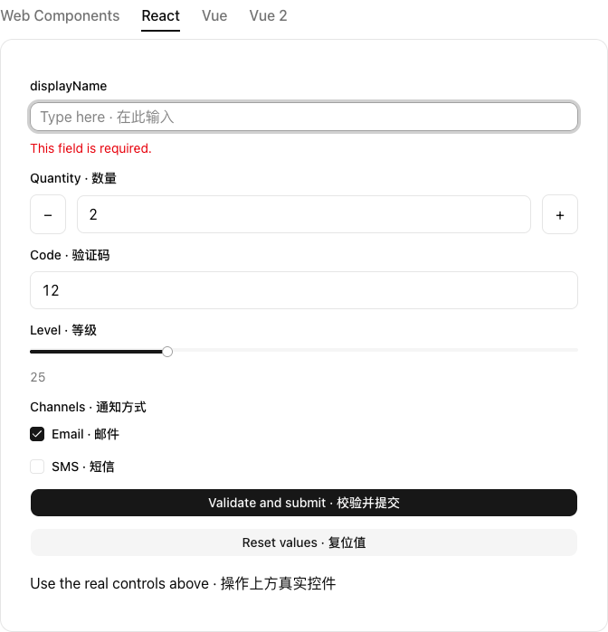
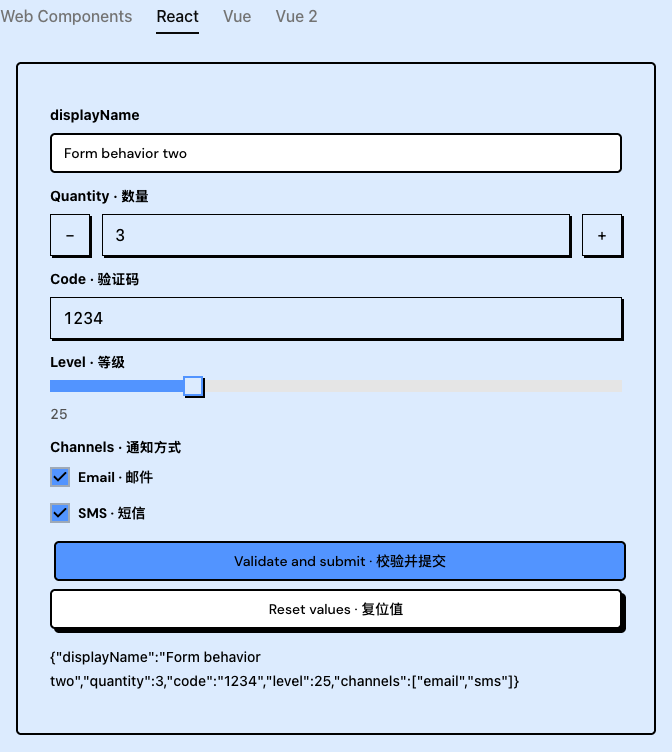
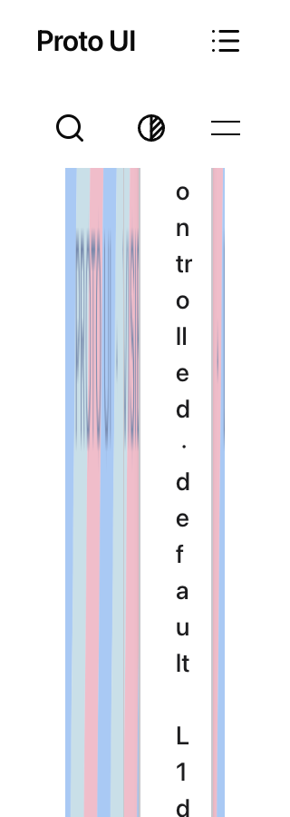

# Current C combination, Form behavior and residual evidence

This packet is bound to `4aad83f80ab29e0a5d4f3c0b63af17e3dcf64e06`, tree `cd35b1f9f6d60c24a99c886ccca9958af0e4227b`. It adds validation evidence; no product source was changed by these observations. The previously published exact-head preview packet remains separate.

Official CI `39056665955`, attempt 1, completed FAILURE: 22 jobs, 12 success and 10 failure. All eight original browser job logs were read and bind synthetic checkout `a247346fd6cbbdaccef82aec13fc6317b69b3dcc`, whose tree equals the product tree. Complete shards 3/4/5/6/7 total 541 pass, 17 fail and 15 skip. Shards 1/2/8 reached the original exit124 deadline without complete summaries, so there is no all-eight test total. Current-head color tests pass 9/9, including mounted recommit; the entire fifth shard remains 84/6/15. General exits on 78 public-doc drift findings before Vitest. Types are934/0errors/0warnings/14hints; package job actually builds39/47, checks47manifests/9policytests and reports4PASS/5ADVISORY. Field25 passes; original Forms10/2 and Collapsible32/4 remain red, with8 separate Collapsible diagnostic passes.

To fill the general-job evidence gap, one existing 67-file C-core selection ran on the actual clean committed head: 1,120 tests passed, zero failed or skipped. The exact selected-file set was checked against the machine report; all11,329 tracked input hashes remained unchanged. Original assertions and timeouts stayed intact. This is local C evidence, not a successful whole CI run.

Two separate actual built-artifact Form behavior journeys ran on Shadcn React and Brutalist React at18:38:32–40UTC. Their actual context was1440×1000/en-US/light; timezone was not fixed or observed. This differs from the original official fixture1365×1000/zh-CN/UTC. One P3 provenance finding (FORM4AAD-CONTEXT-PROVENANCE-001) corrected the initial report's false context-equivalence claim through an additive correction. Original driver/raw reports and the unpublished first projection remain retained; no rerun was used to overwrite history. A fixed hostClock does not establish the same timezone. Both passed invalid-submit first focus, required error and IDREF; valid submit, reset, multi-field editing, checkbox changes, another submit and a fresh submit after a second reset. Six public status snapshots contain the exact five-field values. The existing demo callback was not overridden: this does not claim callback counts or submission IDs. Both cases have empty page/console-error/failed-request arrays. Twenty trusted clicks, eight input and eight change events are recorded; two Runtime-tab clicks are untrusted and are not counted as native user clicks. The original color predicates still record black Label/Field versus destructive Error. This control does not replace original color acceptance or expand to async validation, reentry, retirement/remount, other Adapters or AT. All3835 built files,11329 tracked inputs and149 requested artifact members are bound; browser/server cleanup completed. Fourteen original PNGs plus14DOM/14AX records were inspected.

A separate local WC grid A/B/A control rejects a tempting one-token fix: constraining the direct demo grid shrinks Root from170.609px to14px, but Root scrollWidth82/clientWidth14 creates68px internal overflow; Content still needs82px with32px scalable padding. Restoring the property restores the track width. Horizontal coordinates shifted4px and scrollX was not recorded; this is not exact atomic A/B/A geometry. The deeper shared chain measured Materialscene176px minus64px side padding twice, leaving48px; the readingpane is256px minus40px twice, leaving176px. No valid padding/token was removed and no source patch was committed. Three original control PNGs were viewed; they do not establish a complete responsive-layout repair.

Independent CI triage records two family/test direction mismatches: current draft Brutalist Checkbox specifies no press shadow change, and current draft Liquid Button specifies no whole-host disabled-opacity reduction. Their fixtures need their owners' reconciliation; no production shadow or opacity workaround was added. Tooltip's current Vue2 record has trusted pointer events on one stable connected target but no scale token; pressed state and current logical ownership were not observed, so its C-versus-host/feedback cause remains open. Homepage Select and Shadow query/portal differences retain explicit missing evidence. S4/S5 stop at global preview readiness before their journeys; test titles do not establish Dialog teardown or editing root causes. No new C production root cause is declared from these records.

The archive preserves selected original logs, controls, source/test hashes, member maps and raw/public transformation records. All17 PNGs are original bytes; the three displayed images duplicate archive files. Text paths are sanitized and derived source is not represented as exact execution bytes or guaranteed runnable. The original Tooltip ZIP remains private and hash-bound; this packet does not claim its PNGs were viewed. Existing failures and public history remain unchanged. All local reviews remain human-assisted/unassessed/partial/ABSTAIN, not GitHub approval, full acceptance, Issue closure or merge.
