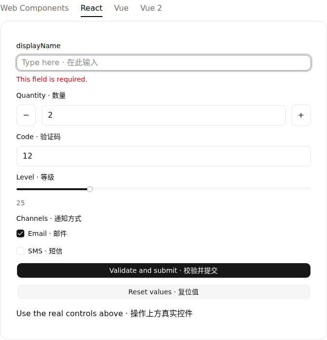
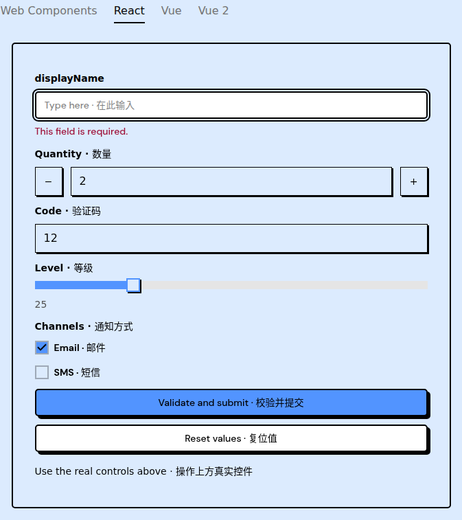

# Failed containing-block diagnostic and current Forms evidence

Commit `4aad83f80ab29e0a5d4f3c0b63af17e3dcf64e06` retains the original seven geometry values before failure-only layout observation. The original four assertions,320px/200% type,overflow1,input and deadlines remain. Adjacent synchronous self/viewport/up-to-eight-parent reads run inside the same browser evaluation only after original bounds fail; they are not an atomic snapshot. Diagnostic errors preserve the original geometry. Current WC Root is light DOM, with source evidence; no generic Shadow traversal or CSS repair was added.

The saved candidate actually ran the original Mac WC/Liquid narrow case:1pass/35filtered, then docs types934files/0errors/0warnings/14hints. Both stages retained all11329 tracked inputs. These precommit bytes match4aad exactly. The healthy result did not execute the new failure branch and does not repair or explain Linux right320.4375. Actual current-head Linux observations remain pending at preparation. Independent local review found0specific issues and remains partial/ABSTAIN, notGitHub approval.

Separately, the original dd315 Forms artifact12109715424 was downloaded with its GitHub SHA256 and exact source/tree verified. Its Shadcn andBrutalist terminal JSON/DOM showinvalid attributes,error text andfirst focus; Label/FieldremainblackwhileErrorisdestructive. Page/capture error arrays are empty. Both included original failed-preview PNGs were actually inspected. These cases stopped at the original color assertion; they do not establish complete subsequent Context/submit/reset behavior or close the oldprovider-errorcause. The artifact hostClock is a fixture, not execution time. These observations belongdd315, not4aad.

The archive preserves selected original logs, source/test hashes, before/after tracked censuses and review records. Its mapping distinguishes original and path-sanitized text; derived text is not represented as exact executed bytes or guaranteed runnable. Original private evidence and earlier public packets remain unchanged. This packet does not claim full CI, strict-budget success, remote preview acceptance, or closure of#883.
