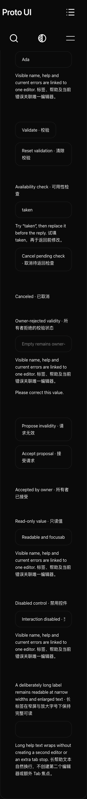
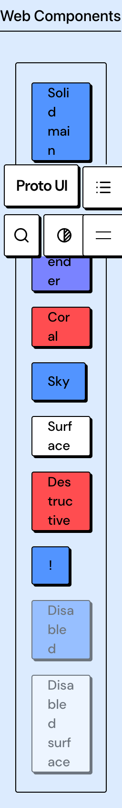

# Keyboard owner P2 — exact 0ecfe2cb evidence

This additive packet addresses [the maintainer’s P2](https://github.com/Proto-UI/Proto-UI/pull/921#issuecomment-6246441557) on PR #921, within the existing Issue #883 C-group contribution. Product commit is `0ecfe2cb76236aa37fee78730423a72a0ddebb7c`, tree `3db37329aae1b2cc3466ab08852b2a9eea6b9d52`, parent `0b68e7ec96f5857a6e1b7b6463b192c695ee753f`, over main `042f1e5740e1a809b9ca238593f5bb01a1f8a8e3`.

Only two files change: the owner-assignment condition now requires `shouldRouteToCurrentRoot(native)`, and the original event-router test gains Enter/Space cases with real marked parent/child roots, parent press registration and child root/global key.down registrations. The original15 cases and all their assertions remain byte-identical outside the insertion. Existing physical ancestor press dispatch is retained. A valid Item still pins its owner before the callback can retire it and return focus to Trigger; fresh keys and unclaimed Portal input keep their existing routes. No public acceptance callback/API, Adapter semantic expansion or spec lifecycle promotion is introduced. Applicable event entities remain draft.

The formal same-test-byte unit baseline is15passed/2failed: both Enter and Space report child root0/global1. The minimal repair produces17passed/0failed. These two runs are precommit saved candidates whose exact source/test bytes bind to the final commit; they are not relabelled as postcommit runs. The clean exact-head combined run executes98files/1303tests, all passed, retaining the prior94-file combination and adding mapping/gate/teardown/default-action controls. Types reports934Astrofiles,0errors,0warnings,14hints.

A separate real Chrome155.0.8059.80 host-contract pairing uses identical privatefixture/driver bytes. Baseline overrides only the exact0b68router Git blob; the other three tracked source inputs are unchanged between revisions. Actual esbuild metadata binds four tracked inputs plusone privatefixture per arm. Each Enter/Space has one trusted native keydown targeted at child; the same event identity records baseline root0/global1 and candidate root1/global1. Ancestor press is actually1 in both arms, supporting the narrow claim correction without imposing a new press-delivery policy. One baseline Enter console404 has no recorded URL; it remains in raw observations without a favicon/root-cause guess. There are no pageErrors or cleanupErrors. All case contexts, the browser and the owned server ended. This fixture is not a full framework, package, AT or all-browser acceptance claim.

The complete clean-head local site build passed. Its unchanged original Collapsible36, Tooltip2, BrutalistButton8 and Field25 browser cases passed71/71. The original Homepage settings case separately passed its complete two-family/four-runtime journey, with10other cases explicitly filtered. Existing Select retirement/focus-return/fresh-key/Portal unit controls are retained in the17-case file. No deadline or existing assertion changed. The48 automatically captured UI PNGs are included as supplementary C-combination output, with contact-sheet review scope recorded separately; capture counts do not establish whole-page visual or AT acceptance. Six contact sheets were inspected, with four originals additionally opened. Real limitations remain: Header overlaps part of the 200% Brutalist button column and early Field capture regions; narrow Field captures truncate some long right-edge text, and Liquid backdrop text competes with labels. These locator-region images do not alone prove page overflow or the active focus/hit state. No cause is assigned to the new router condition and these visual limitations remain unresolved.

The actual exact-head preview workflow39130514939 passed its full generated-artifact test, then uploaded artifact12137477831. Producer test ZIP21206298bytes and raw Actions ZIP21140840bytes are separate containers. The existing trusted publisher used live GitHub APIs and admitted generation `p921-r39130514939-a1`; an independent verified download and complete member comparison retained3836files,669HTML and104046910expanded bytes, with every admitted file byte-identical to the downloaded Actions ZIP. Full pages/resources and admission limits were retained. Original settings+Tooltip then passed3tests/10filtered on a separate temporary localhost static server of these admitted bytes. This local admission/native proof is not remote service availability, serving-policy/CSP, every-page or all-AT acceptance.

Canonical CI39130514855 has failures and unfinished work at the snapshot in summary.json. Its general job reports78public-documentation/export classification issues before general Vitest; it is not a successful test run. Other captured native/layout/style failures remain visible with their original logs, without declaring them all pre-existing or assigning them to the keyboard fix. Collapsible’s independent official job passed. No Actions were manually rerun, cancelled or dispatched, and no assertion, deadline, family coverage or external permission was weakened. Local independent source/evidence review remains unassessed human-assisted partial/ABSTAIN; current-head maintainer approval and integration remain outstanding.

`evidence.zip` retains exact commands, results, native event/state observations, source/commit/fixture bindings, original failures and partial reviews. Text is path-sanitized derived evidence; raw/public hashes are in public-mapping.json. Sanitized source and bundles are not claimed to be the exact executed bytes or directly runnable. PNGs retain original bytes. Native/unit/official repetitions overlap and are not summed as unique coverage. Earlier evidence packages and published product history remain unchanged.
