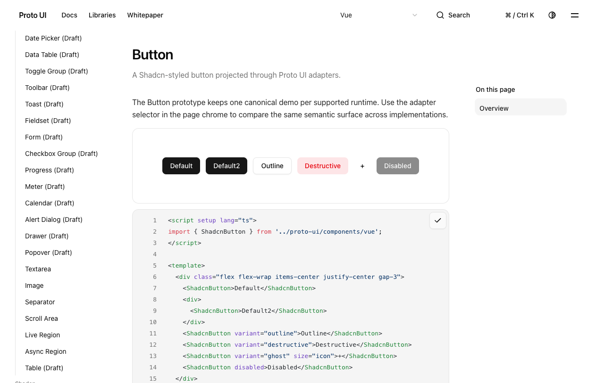
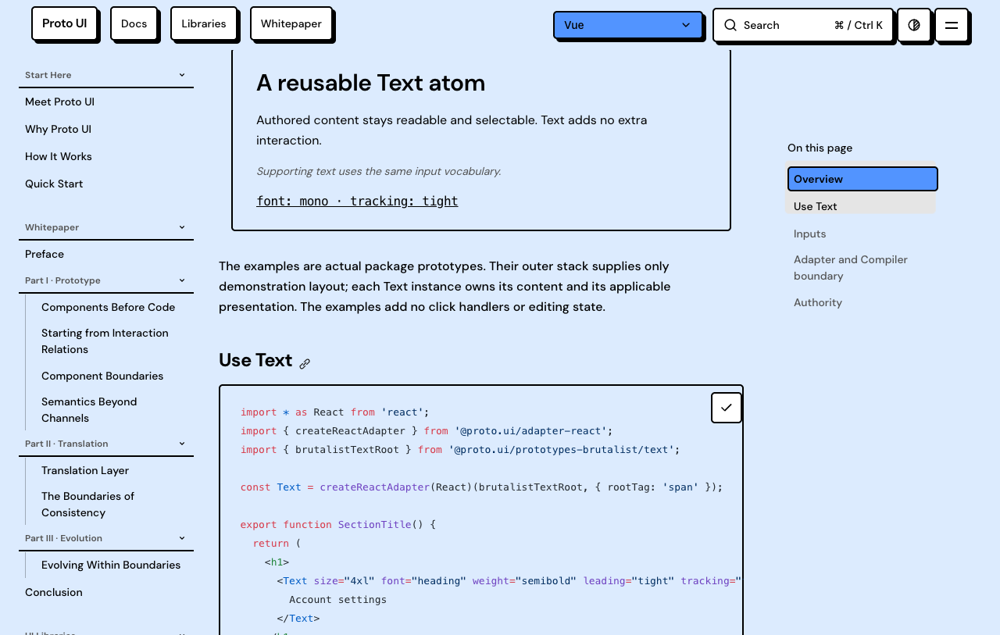

# Mounted recommit repair and source-bound preview follow-up

This packet distinguishes two actual source revisions.

`dd3151b2efc97b8c3d541e68d374f0a87f1dcdfa` fixes the maintainer P2 in [comment6237404593](https://github.com/Proto-UI/Proto-UI/pull/921#issuecomment-6237404593). Early readiness no longer stands for successful physical reveal: only a winning commit records the current gate. The VNode retains pending until that gate is revealed. A plain synchronous mounted recommit was reproduced in actual Vue/happy-dom (1pass/1fail) and Chromium (1fail/8filtered), then passed the unchanged unit pair and all9 native cases. The original8 cases,12rAF, alpha and timeout assertions remain. The unit checks marker lifetime through actual controlled frame delivery and subsequent normal transition restoration.

Broader local results: Vue432pass/5baselineDialogfail; Spec160pass/1baselineDropdownfail; prototype catalog536 findings exactly match169 control. Types934files,0errors,0warnings,14hints;47/47 public packages and47 manifests. Finf budget mode reports4PASS/5ADVISORY. All failures/setup controls are retained. The initial Spec missing-evidence failure occurred before the new file entered the real Git index; the strict check passed after actual enrollment, without weakening it. Workspace/Agent projections were generated; ignored outputs were not committed. This is partial evidence, not all CI success or approval.

The actual website preview belongs to the earlier `16917f06`, not dd315. The trusted publisher read live GitHub identity and admitted artifact12107814815 from run39052330622. An independent ZIP read and every-file comparison confirm all3835 files,669 HTML pages and104045457 expanded bytes were retained unchanged. The original ZIP remains in local evidence; the published hash/member map identifies it.

At17:22:16–26 UTC the actual local catalog and eight clipboard-equivalence journeys passed, with9 original PNGs and server exit0. Runtime selection used the normal preference, not runtime-menu clicks. A unique sentinel was not written before each copy, so this establishes eight post-click equality checks rather than eight independent fresh writes; Brutalist uses the same447B React example. These captures are not initial-frame, all-page layout, AT or remote-service acceptance. The two images below are duplicate displays of those original passing captures.

The new9-case fixture generated17 PNG files byte-identical to the already actually viewed captures; the reuse map is explicit. First-recommit paint evidence is the actual visible-frame data, not those later lifetime screenshots. All text path transformations are mapped in `PUBLIC-MAPPING.json`; transformed source is not represented as exact executed bytes or guaranteed runnable. No raw ModelTrace samples/private context are published.

Canonical dd315 CI, a dd315 website artifact and independent maintainer approval remain separate future conditions. Source169 results are not reassigned to the new commit. Existing Form colors, Linux Liquid Root geometry, S5 split refusal, general documentation/catalog debt and baseline Dialog/Dropdown findings remain open.
