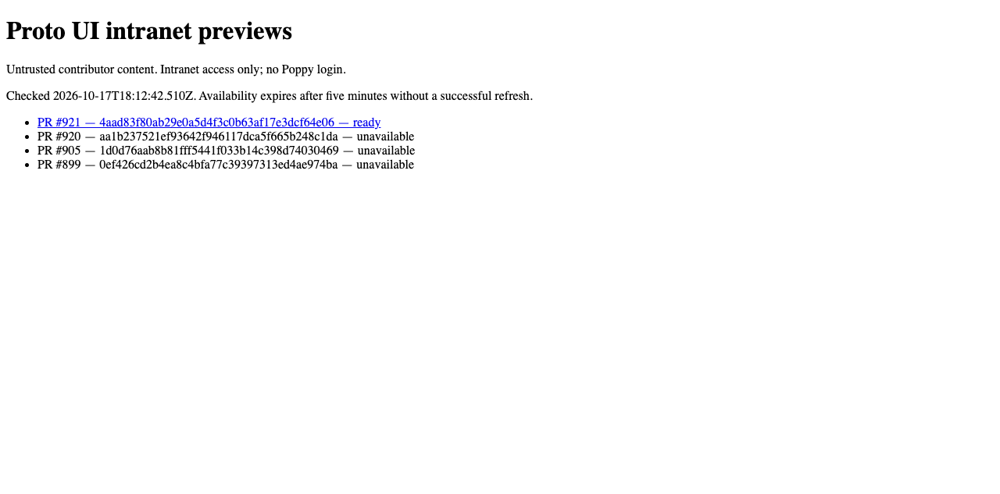
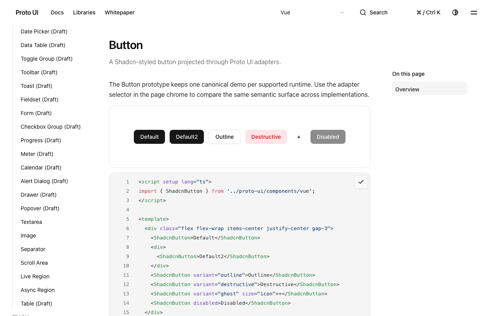
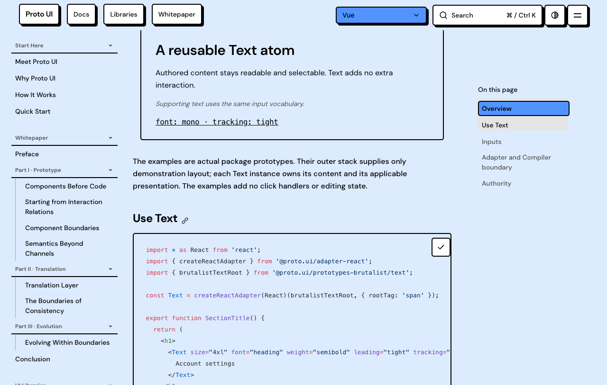

# Actual current-head documentation preview

Source `4aad83f80ab29e0a5d4f3c0b63af17e3dcf64e06`, build `39056666060`, artifact `12109493824`, generation `p921-r39056666060-a1`. The actual GitHub Actions ZIP contains 21,145,390 bytes, SHA256 `224f7065dbd8968d73b458ef3d42f04e3050a2fc9c51f621f56f5e27402e4f83`. The complete generated-artifact admission regression passed 1/0 in the build job: 3,835 files and 104,045,490 expanded bytes. Its separately packaged ZIP contains 21,209,997 bytes; it is distinct from the Actions ZIP.

The existing trusted publisher read live GitHub identity and metadata under a real exclusive root lock, admitted Ready and retained every file. An independent downloaded-ZIP member comparison found all 3,835 files, 669 HTML pages and 104,045,490 expanded bytes identical to the served tree. Intended pages and resources were retained, and the 100 MiB admission bound remained unchanged. The original complete ZIP remains in local evidence; this packet carries its hash and every-member map.

Actual native QA ran 18:14:14.634–18:14:25.123 UTC on Chrome 155.0.8059.80: catalog navigation plus eight new clipboard journeys across WC, React, Vue and Vue2 in Shadcn and Brutalist. Each writes and reads back a distinct sentinel before the native copy click, then verifies the complete expected source text. This supports eight new clipboard updates. Shadcn recorded 12 trusted clicks and Brutalist 4; all eight case pageError arrays were empty, and both drivers and the server exited 0. The catalog itself had no separate pageerror listener. Runtime selection used existing preferences; no Runtime menu clicks are claimed. All four Brutalist cases copy the same 447-byte React example.

The independent reviewer individually viewed all nine original current-head PNGs. Root also viewed the catalog, Shadcn Vue and Brutalist Vue. The catalog is 1280×633; case captures are 1280×813. The correct head, Ready state and copy feedback are visible. React/Vue2 and Brutalist long code lines or tails extend beyond the viewport. These captures do not establish full-page layout, first paint, AT, upstream pixel equivalence or remote hosted acceptance. The three displayed images below duplicate those nine files; they are not additional executions.

The archive preserves raw/public hash mappings, actual execution receipts, the build log, complete member comparison and all nine original PNGs. Private paths are redacted in derived text; it is not represented as exact executed source or guaranteed runnable. Existing failed evidence and public history remain unchanged. Local independent review reports zero specific findings and remains human-assisted/unassessed/partial/ABSTAIN, not GitHub approval. Full CI, Collapsible ownership and remaining C/shared-owner work remain separate.
