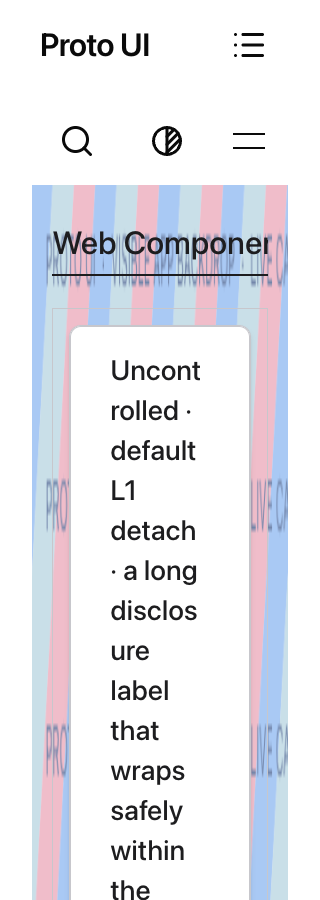
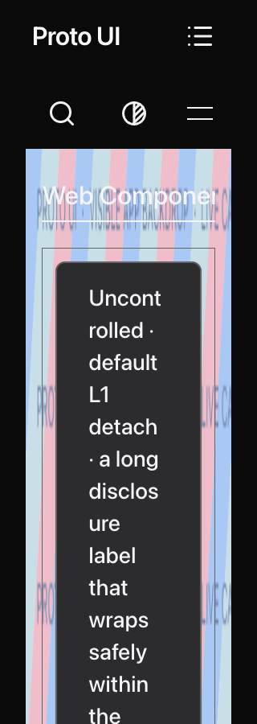
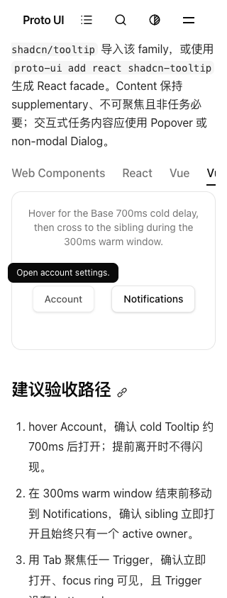
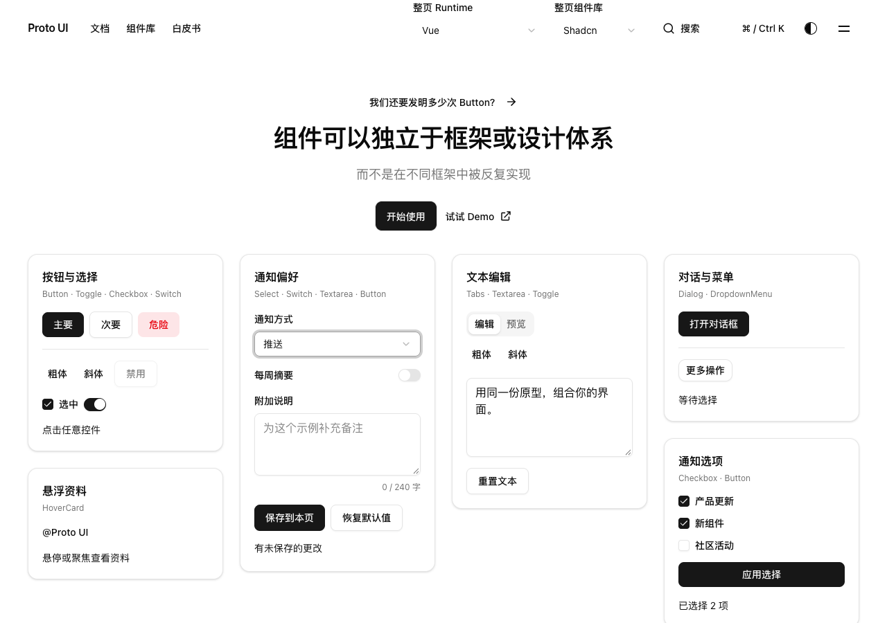
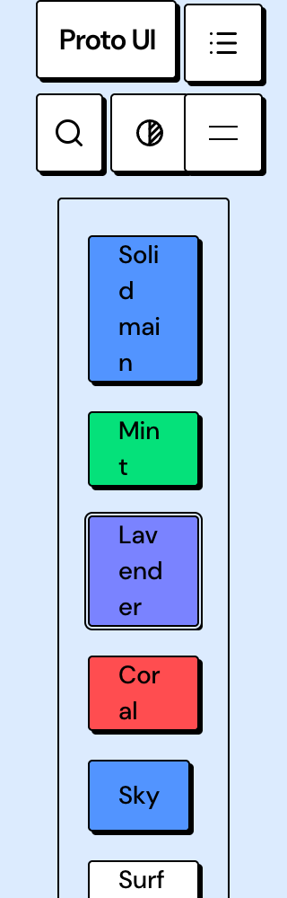

# C preview layout and input ownership evidence

This additive packet binds final source `cc3e5670a3a83d4f797fa2af7d942aae876b0f2b`, tree `7b7a3140ce12156a7f8555174778d0580df3d588`, over main `042f1e5740e1a809b9ca238593f5bb01a1f8a8e3`. Three normal signed commits fix the shared reading/material preview constraints, the missing Vue2 instance marker and repeated keyboard delivery after focus return. Existing hover/prominent-tint registration, full documentation pages/resources, original browser assertions and admission limits remain. This is a bounded current-user C continuation; it is not approval, merge, activation or whole-project completion.

The actual complete 4aad artifact provided the baseline. A narrow material scene was176px with64px padding per side; its48px mount left a46px demo box whose implicit grid overflowed its own content budget. The prior one-track-only control created68px internal overflow and remains rejected. A later four-edge padding control isolated horizontal pressure but did not execute the eventual inline-only candidate. The source repair removes duplicate narrow reading padding, preserves2rem block material padding while bounding inline padding by8% of its containing width, and declares the demo's existing single column with generic grid-cols-1. Actual final-source light/dark320px/200% captures and numeric facts are included, separately from those interventions.

Tooltip baseline trusted pointerdown/mousedown hit the stable Vue2 Trigger, with Vue2 marked ancestors nested under actual WC Tabs. The shared router omitted Vue2 from its recognized instance markers. WC/React/Vue held samples showed scale while Vue2 did not. The unchanged original Tooltip test failed its original1000ms press predicate. The same four-marker physical/logical owner matrix was8pass2Vue2fail(child0,parent1,native1), then10pass after adding one existing marker. Final-source native tests and held-state captures retain the expected scale. No new asTrigger, activation owner or public state API was added; missing data-pressed never supplies a logical-state claim.

The original Homepage settings case reproduced a separate Select failure on Shadcn/Vue. One trusted Enter selected Push, closed old Content and returned focus to Trigger, then reopened replacement Content without another keydown. The visible selection had committed. Private observer IDs identify objects within each run; the page's projection generation remained3. The fix records the existing owner only when an actual press consumer accepts the native keydown, retaining that ownership through view retirement/focus return. Foreign root key.down and repeated press are rejected for that consumed input; global keys, empty consumers, independent registrations, fresh keys and unclaimed Portal fallback remain. The formal same-fixture unit result is14pass1fail(keys1/presses1) to15pass; original tests and formatting-only differences are preserved.

The unchanged settings case then passed its complete two-family/four-runtime loop. A separate read-only observer pass records eight trusted Enter/Home/ArrowDown/Enter sequences, zero dropped records and final closed/focused Push Trigger states. Some WC/Vue2 Content remains hidden rather than physically removed. The green screenshot follows the original close/text/focus assertions; it is not a first-frame or long-term-stability proof. The raw node checkout and served-page provenance remain distinct, including precommit source binding to the final Git objects.

The existing trusted publisher admitted exact-head producer39089820629/artifact12121993854 before the native copy run. A separate independent ZIP download/member comparison followed that run:3835 files,669HTML,104045802 expanded bytes,21142412-byte raw Actions ZIP. Local output3836files is separate; their asset/hash graphs are not declared equal. Eight fresh-sentinel copy journeys ran on the actual admitted origin at02:32:10–20UTC across four runtimes and two families; the independent ZIP download/member comparison ran later at02:32:46–02:33:23UTC. Runtime was preference-selected, not a Runtime-menu click. Shadcn copies447/574/537/582bytes; Brutalist copies the existing same447-byte page sample in each runtime. The driver configured1280×900; the eight case PNGs are actually1280×813 and catalog PNG1280×633, with no inferred cause for that difference. Nine original captures were inspected; source panes may be clipped and do not prove all-page/AT/package correctness. A separate static server of these exact official bytes also passed the original settings and Tooltip files:3tests passed,10filtered, without counting repetitions as new unique tests. The publisher/native server ended; Ready was observed during execution, not a claim of a permanent live host.

Machine results, exact commands/counts, full selected-file reconciliation, source/blob bindings, complete producer/admission compatibility and execution boundaries are in summary.json and evidence.zip. Repeated or overlapping tests are not summed as unique results. Original red runs, initial setup errors, rejected controls and partial cross-context reviews remain visible. All local reviews are human-assisted, unassessed, partial/ABSTAIN; canonical CI, independent maintainer acceptance and deployment remain separate. Text is a sanitized projection with raw/public hashes; transformed source is not represented as exact executable bytes.

The inherited raw validation snapshot time predates later official-preview sections. `timing-note.json` and the outer `initialLocalValidationObservedAt` / `packetAssembledAt` fields distinguish these stages; original raw reports and mappings remain unchanged. Historical Brutalist element captures retain clipped Runtime tabs at100% and mobile Header occlusion/narrow label wrapping at200%; passing geometry is not unobscured or complete readability acceptance.

An additive `focus-control.zip` retains the subsequent review of those eight crops and one bounded current WC control. Mint programmatic focus is setup; three trusted Tabs to Lavender, Coral and Sky kept the focused target fully below the actual sticky Header (bottom192px), inside the viewport and center-hit-testable. No focus-occlusion counterexample was reproduced. This does not erase the old crop/readability limitations or prove other Runtime/AT behavior.

This cc3e checkpoint also retains the completed canonical failure in `ci-summary.json` and `canonical-ci.zip`: ordinary CI22 jobs/13success/9failure; five complete browser shards549pass/9fail/15skip, with1/2/8 exit124 and no whole-eight total. The separately completed QuickStart suite is12pass/8narrow overflow failures (two320px and six390px, original14px against1px). This is a current C-related shared-layout problem requiring its own repair evidence, not an inherited/other failure or a green combination. Package actually builds42/47 public packages, checks47 manifests and reports4PASS/5ADVISORY. Later source corrections must keep this checkpoint's original head, timing and failures distinct.
