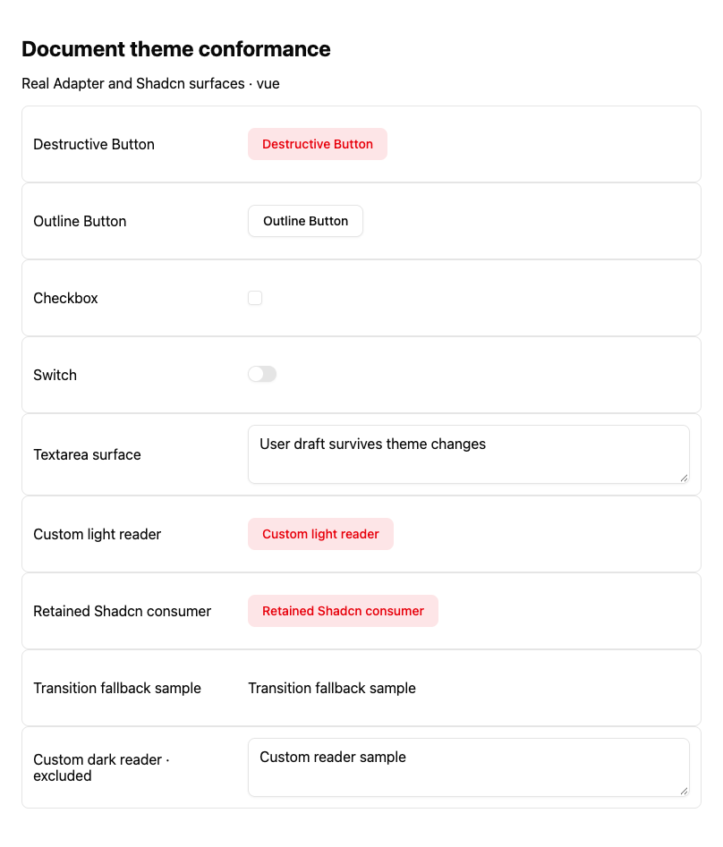
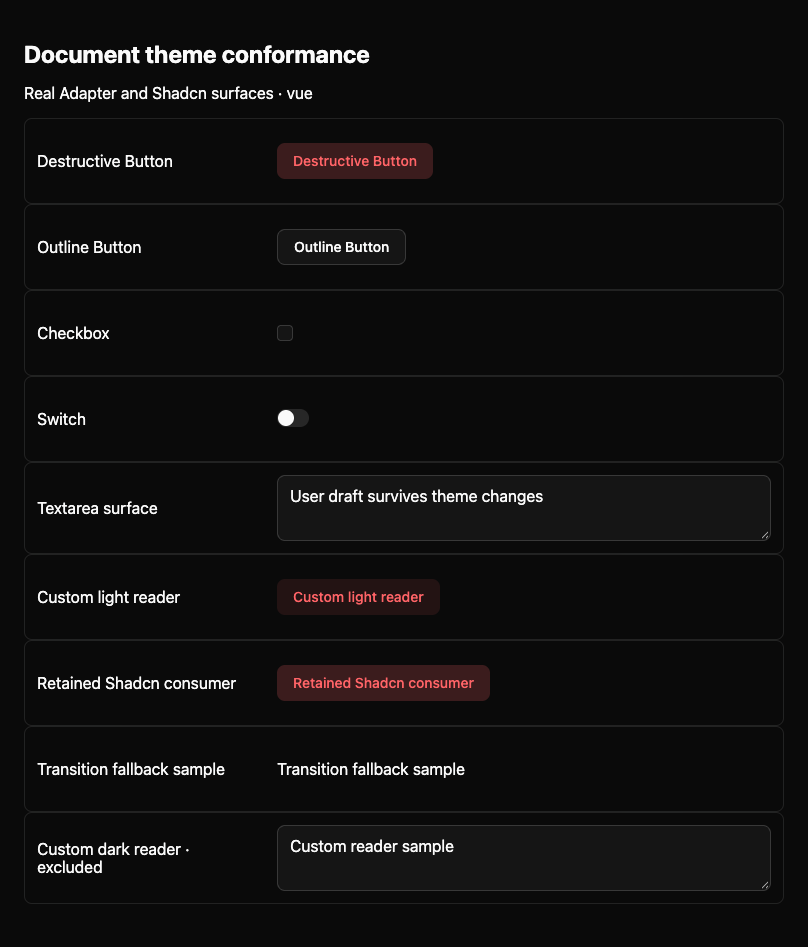
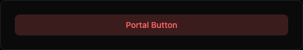

# Issue #883: Vue initial reveal and C observations

Source: `16917f0666d8916b92d5d5d3656029369295488c` (base main `042f1e57`). This is an additive 2026-10-17 UTC execution packet, prepared on 2026-10-18 Asia/Singapore. Earlier #901 evidence and failures remain historical records.

Vue first reveal exposed a real 150ms CSS transition from transparent to the already-correct dark recipe. The repair reuses the existing revealing marker and layout scheduler. The Switch oracle follows the current draft `P-SHADCN-SWITCH-STATE-DRIVEN-STYLES` (`bg-input/80` with input alpha 0.15 gives 0.12). The focus fixture actually delivers initial presentation frames before its unchanged focus retry assertions.

The original complete eight-case browser suite progressed from 8 failures, through 7 passes/1 failure after the oracle repair, to 8 passes after the Vue repair. Its final 24 initial-dark groups each contain 12 correct visible, nonpending samples. All four lifetime cases completed identity, native draft, remount, portal, Props, Transition and resource-release checks. These are bounded Chromium/macOS observations, not all-browser or AT acceptance.

Final Vue Adapter checks: 430 passed/5 failed across 86 files. The same five Dialog failures occur with the original main source in a two-file control; the earlier 429/6 failure is retained. Types: 934 files, 0 errors, 0 warnings, 14 hints. Public builds: 47/47 and 47 manifests. Finf budgets: 4 PASS/5 ADVISORY, not strict-budget success or canonical CI for this head.

Collapsible remains open: main Linux reported four right 320.4375 violations; the Mac WC 200% control passes. The second commit adds only conditional Node logging of the original geometry and Root/Content identity before the original four assertions. No DOM read, input, timeout or320/1 bound was changed. The logging failure branch has not executed locally; the next natural PR CI is needed.

S5 remains open: the diagnostic hit the original 150s case timeout; the 60s readiness error reached its catch only after page closure. Eighteen page errors match the existing WC split `transition-all`/used-value-rounding refusal. Actual nonready previewers and border-width inputs were unavailable. Facts, DOM, AX and PNG capture attempts all failed; there is no S5 screenshot. This does not prove a C lifecycle cause or authorize weakening the style-role guard. The Form conditional-style collector gap remains a separate owner boundary; current main push CI did not run a Form special job.

`execution-evidence.zip` contains the retained failures, controls, successful source-bound runs, original native PNG files and public path transformations. `PUBLIC-MAPPING.json` gives raw and public hashes for every member. Text whose private paths were sanitized is derived evidence, not exact executed bytes or guaranteed runnable source. PNG bytes were not edited. Native runs preceded the commits; source hashes bind their actual execution bytes.

The three PNGs below show passing Vue lifetime stages, after relevant assertions. They are not initial-frame or failed-frame captures. The failure-catch PNG inside the archive is likewise a stable post-failure image; initial timing evidence is the recorded native frame and CSSTransition data.

Local independent review found zero specific source findings and remains unassessed/partial/ABSTAIN. It is not GitHub approval, integration or release authorization. Canonical PR CI and external review remain pending at preparation.
