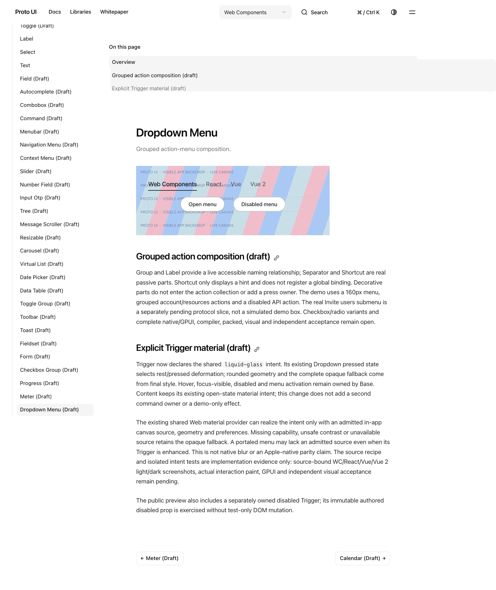
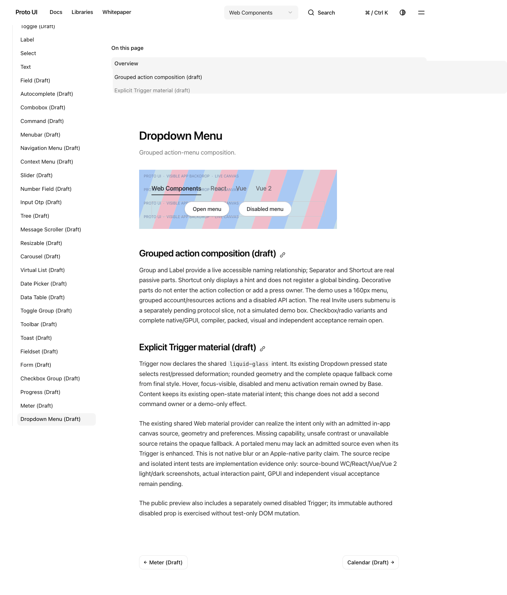
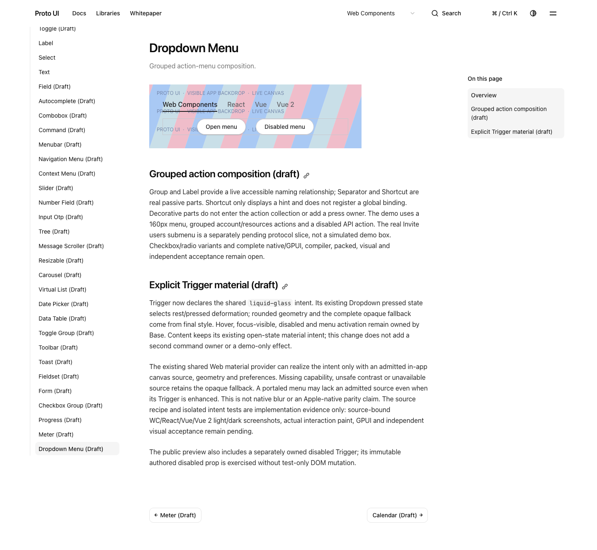
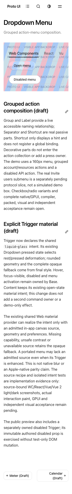

# Issue #883 C: exact ac1990c7 combination evidence

This additive packet binds signed PR #921 head `ac1990c78f60acb73661845f6add9d3ff307023e`, tree `14d99b90175d2a23528940218658568f324c9254`, retaining accepted `main@b928a56c6909835771fc2131503b4a7139db738c`. Local exact-head verification is **11 files /269 passed /0 failed**, 18:51:27–19:04:48 UTC on 2026-10-22. Canonical primary CI39834975301 subsequently reports **FAILURE** (updated19:19:11UTC). The old19:16queued snapshot is historical; current result and exact failed-call records are added in this v2 packet. Some jobs remain nonterminal in paginated metadata; no all-CI-green claim.

`REPORT.md` explains the five bounded increments and source epochs. `REPORT.json` records counts/boundaries. `SOURCE-BINDING.json` binds selected final sources. `MANIFEST.json` maps every archived public representation to its private raw SHA/size and records the unchanged PNGs. `evidence.tar.gz` contains selected terminal logs/reports/source snapshots and the identical manifest; it is not the complete site artifact or all media. Full site ZIP and all3837 extracted files remain preserved separately, without page/resource pruning.

The four original fullPage PNGs were actually viewed by root and the trace peer. The Portal pair is a separate post-verdict display, not the original failure frame. Built screenshots use the real exact-ac artifact, not source/dev output or a synthetic Ready catalog:

   

Historical failures remain in their original packets: [exact35 local/Scroll](https://github.com/HyacinthHaru/Proto-UI/tree/53ed7df108d8f493dc3ed4a0f40d4281f0159b35/evidence/2026-10-22/issue883-query-scroll-35b15ea7) and [natural35 same-failure CI](https://github.com/HyacinthHaru/Proto-UI/tree/9025b88f6a81707dc40d6020cc64d9156831a7f1/evidence/2026-10-22/issue883-hosted-query-35b15ea7). The old three missing browser getter batches remain missing. Green controls do not close them.

All local reviews are human-assisted, partial/ABSTAIN, not GitHub approval or acceptance. Draft lifecycle, keyboard owner controls, original assertions/deadlines and existing hover/prominent-tint registration remain. No whole#926 import, release, permissions/secrets change or Actions rerun/cancel is performed. Machine paths and unnecessary environment/timezone values are removed only from explicitly mapped public projections; original inputs/observations remain unchanged privately. Published derived source is not claimed as executed source bytes or standalone runnable tooling.

This v2 includes two separately bound natural Search failures: primary16pass14fail and isolated13pass17fail. All18newfailed Docs calls now retain same-call browser selector/getter batches and latecombobox before context-close marker; original1s results remainfailed. Readiness is split by actual observed windows, not uniformly blamed on lateentry. Full primary325member/isolated182member ZIP manifests are retained; selected text projections are not all-media review. The unpublishedv1 had one macOSTEMPpath projection finding, corrected only in v2 while preserving raw/v1.
