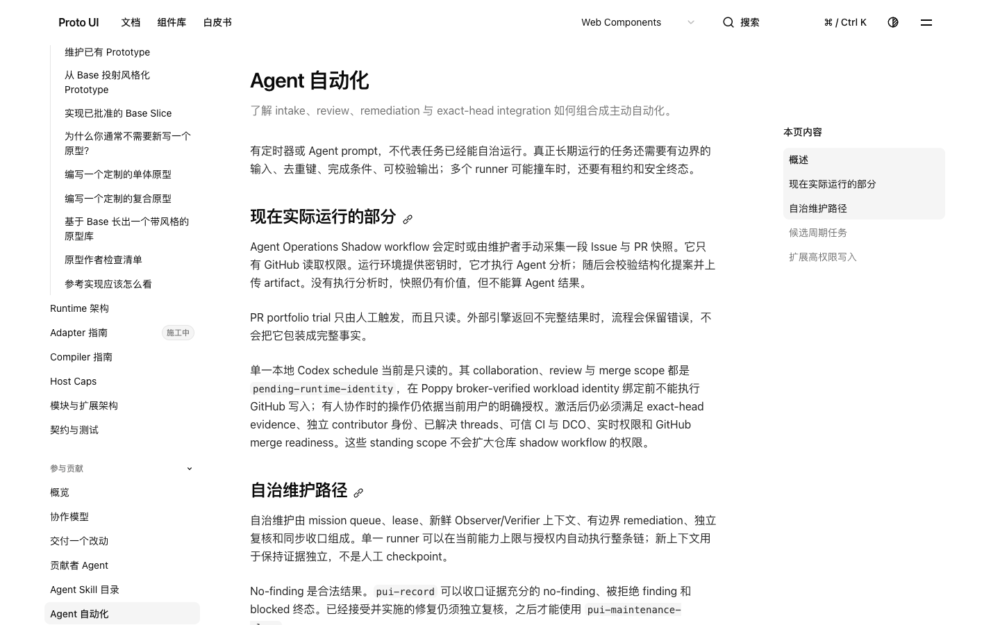
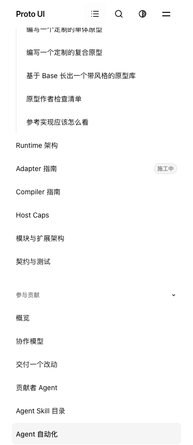
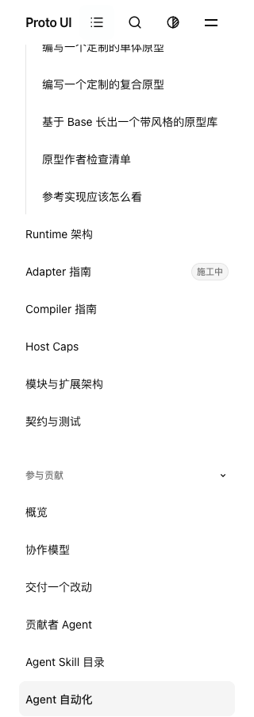

# Main integration and sidebar reveal checkpoint

This local evidence checkpoint targets source commit `8bfea32042ab12acdcb821ca7a3c77e1ab1946de`, tree `954f4fbefd35d3c89b47618dc498ce00820e168a`, after integrating main `b928a56c6909835771fc2131503b4a7139db738c`. It preserves the actual failures and controls that separate two test-fixture repairs from the application sidebar repair. It is partial evidence, not formal approval, full C acceptance, hosted CI acceptance, or an accessibility audit.

The signed merge `23221b26` has tree `a56a2425`, whereas the earlier 144-file execution used staged union `b97b50f6` with physical HEAD `6a4e2b3d`. The mandatory hook formatted three incoming MJS files; the source audit preserves that difference and its configured-formatter/parsed-AST comparison. The 144-file result was 1,939 passed / 8 failed. The signed merge's original 176 browser cases were 174 passed / 2 failed: the native platform modifier control and the initial sidebar reveal. Neither result is relabelled as execution on the final commit.

The two subsequent commits are test-only. `1a8ed9d8` uses Playwright's `ControlOrMeta` for two native modifier inputs: the actual macOS control showed Control produced a context menu without a click, while ControlOrMeta produced the expected trusted Meta-click. The original case then passed with nine filtered. `d2058a7c` supplies the shared Happy DOM contract's missing cross-document insertion/adoption behavior inside that case, restoring the scoped spies in cleanup. Original main/current Node failures, two private setup failures, the four-variant real-Chromium adoption control, and the final shared-consumer 106 passes remain separate. This is not an Adapter production repair or general DOM-shim admission.

The sidebar production change keeps the existing route-entry request alive when its own pending scroll owner changes offset before projection settles. The observed failure had 36 events, no dropped events/errors: a write to 8749 was followed by a same-owner scroll at 8981 while a measurement was queued. The old branch yielded and canceled that work; later projection/resize/font callbacks could no longer finish the initial reveal. The new guard preserves explicit wheel/touch/pointer/key yielding and settled-scroll behavior. The same unit source was 12 passed / 1 failed before and 13 passed after. It does not establish a particular browser scroll-anchoring cause.

The browser controls are retained, including the failures:

- Chrome 156.0.8078.47 reached the initial revealed row after the repair but failed the original wheel predicate. A private event trace received the trusted, unprevented wheel and recorded helper yielding without a later scroll write. Two independent pure-HTML arms also failed, including a bring-to-front control.
- The locked Playwright 1.58.2 full Chromium 145.0.7632.6 pure-HTML control passed. With that engine, the original helper still failed the original initial-visible predicate at line 1818. The fixed helper passed the desktop sequence, then failed the unchanged 390px pointer target check.
- The failure-only pointer record identified `astro-dev-toolbar` at the original point `(195, 877.5)`. Repository CI already disables that project-level development preference. The supported preference command and before/after readback are retained; there was no application CSS/DOM hiding, forced input, global preference change, or timeout relaxation.
- With the matched engine and project `devToolbar=false`, the complete original sidebar case passed at 1440/390/320, including native wheel, manual ownership after late geometry, and reload. That precommit run remains `d2058a7c` plus the exact two-file candidate, not a new final-head or hosted execution.

Here “matched145” means the local experimental full-Chromium revision 1208 supplied by the pinned Playwright 1.58.2 driver. It does **not** mean the canonical CI browser. The current workflow selects its installed system browser with `command -v google-chrome || command -v chromium || command -v chromium-browser`; its actual engine must be read from that run. The project preference follows the existing CI setup, while browser/OS and other environment boundaries remain separate.

Actual final-head local executions are listed below. A failed aggregate remains failed, even when its focused C cases pass.

| Execution             | Passed | Failed | Filtered | Exit |
| --------------------- | -----: | -----: | -------: | ---: |
| final-node145         |   1956 |      4 |        0 |    1 |
| final-native176       |    176 |      0 |        0 |    0 |
| final-native-portal16 |     16 |      0 |        0 |    0 |

The candidate type check reported 937 files, zero errors, zero warnings and 14 hints. Its 11,375-entry tracked-source census matches the final sources; this is source reuse of a precommit execution, not a new postcommit type run or an instrumented dependency closure. A later canonical type run, when listed below, is a separate execution. Final authoring passed. The catalog command failed with 492 diagnostics across 849 declaration files / 1,214 entries / 338 P entities; this is the actual current result, not the older 536 count or a newly executed main comparison. The four Checkbox token failures and CLI collection ownership are not silently reassigned or declared fixed. The timestamped coordination record does not infer an owner acknowledgment from silence.

The current **8bfea canonical** main run39744816321 completed with failure: actual complete pagination contains22 jobs,13 success and9 failure. Its real plan declares General1268 files, browser file counts[11,11,10,10,10,10,10,10], and26 production-excluded files. Synthetic checkout81b2b5ca has the same954f4fbe tree as8bfea. Complete shards3/4/5/6/7 total549 passed /9 failed /15 skipped. Shards1/2/8 exited124 without complete summaries; those subtotals are not an all-eight total.

Canonical types reported937 files /0 errors /0 warnings /14 hints, separately from the earlier local candidate type execution. Package output contains45 actual build records among47 configured packages,47 manifests and9 policy tests; nine budget measurements are4 PASS /5 ADVISORY. General stopped at78 public-doc drift findings before Vitest. Equal old drift rows do not establish a common cause.

Observed whole-file results include NativeLinks10, Header16, Shadow111, Collapsible36 and colorScheme9 passes, including files inside deadline-exited shards. Main Homepage was8 passed /1 Brutalist failure, while its mobile sequence completed12 stages. The original family poll rejected at1000.429ms; its third query returned78.747ms later. Under the recorded clock brackets, the root writer/MO occurred before rejection, but the utility getter executed around1077.20–1078.32ms, after the deadline. Bounded drain completed in78.481ms with no pending references. These observations do not rejudge the failure, prove the complete family transaction had finished, or isolate pure network/browser-queue causality.

Dedicated outcomes remain separate: Dialog candidate8 passed; baseline15d retained the expected7 geometry +1 not-offered classification. Portal-direction and Homepage capture timed out in font installation before their browser tests ran. Startup8bfea was23 passed /4 old-Value-selector failures; its separate baseline48b27 passes are not candidate passes. Dedicated Search was20 passed /10 failed (six initial-ready and four role predicates); ordinary-shard Search has its own larger failure set. Density preserved eight Shadcn home failures with measured36px against the original32±1 oracle. None is erased by local green controls or reassigned to a blanket inherited cause.

This checkpoint remains8bfea even though later test-only commits b1629e2a/cf4848c4 exist. Their candidate and postcommit results belong to a separate increment. The source-bound detailed reports and all selected original job logs are in the archive; these five-run findings do not claim every repository workflow/check or complete C acceptance.

`evidence.zip` contains 398 selected raw-source projections plus `PUBLIC-MAPPING.json`. The map records every original/public SHA-256, size and disclosed transformation. Public source/scripts and logs are sanitized evidence derivatives, not the exact execution bytes or a standalone runnable recipe; the original private files and hashes remain preserved. No browser cache, private preference backup, model samples/context, credentials or operational handoff is included.

The archive contains 10 selected original viewport captures from distinct runs. The three displayed final-head images are the principal repaired-sidebar frames. The baseline visibility failure, two earlier Header frames, precommit sidebar frames and Toolbar obstruction remain historical controls. They have not been recolored, cropped or re-encoded. The root's explicit view receipts delimit actual inspection; these images do not cover every generated frame, the full scrolling document, assistive technology or official artifact admission.

Relevant Native Link / Portal catalog entities remain draft; the existing application record explains the bounded nearest-edge behavior without creating a new Scroll protocol. The packet and peer reports preserve partial / ABSTAIN and do not constitute a GitHub approval or closure of #883.
