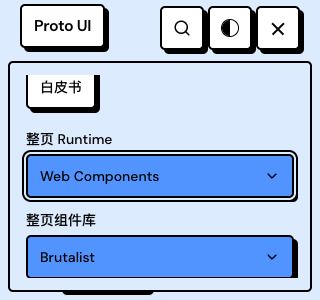
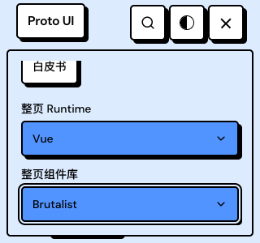
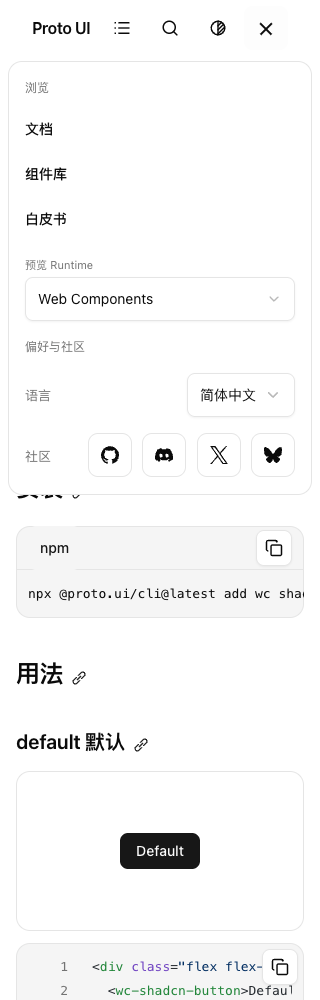
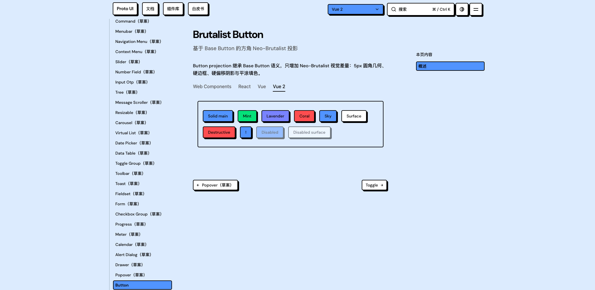

# PR #921 query and Scroll evidence

This packet records the user-directed C-group investigation on main b928a56c and source head 35b15ea7. See [REPORT.md](REPORT.md) for actual procedures, failures and remaining debt. [MANIFEST.json](MANIFEST.json) maps selected private raw inputs to the sanitized bytes in evidence.tar.gz. Source derivatives are not the executed bytes or independently runnable programs.

The complete b2 documentation preview ZIP remains preserved locally: 3,837 files / 669 HTML / 104,068,212 expanded bytes, SHA256 1bb30214b1123eea3ef92dd8973a1f80076467e36e539be88c45ca72e3ec9188. Producer/default admission records are archived; the full 21 MB ZIP is not duplicated into this evidence branch. The later exact35 preview is separately retained complete:3,837files/669HTML/104,068,255expanded bytes; ActionsZIP21,145,734bytes, SHA2563c2ea2074a20ced97e9c16a06a15212bb28122b7f98e5634fccc760dd4091a64. Originalproducer defaultadmission and localdownloadedZIP/selfextraction admission eachpassed1 withdistinct sources. No local rendered generated-artifact browser check is claimed.

The original PNGs below are from the exact final-head local development-server run, without pixel editing/re-encoding. Their scope is the named interaction and viewport, not all-page visual or accessibility acceptance.

Brutalist narrow menu open, WC selected, runtime field focus ring.

Brutalist narrow menu open, Vue selected, family field focus ring.

320 × 1000, navigation/preferences overlay open after reveal. Passing geometry capture, not a failed getter frame.

2048 × 1000, Vue2 example selected; HeaderSelect remains WC.

Historical negative observations, the b2 sampling-time gap and collector limits remain in the reports. Independent local reports are partial / ABSTAIN, not GitHub approval. This evidence branch must never merge into the product branch.
