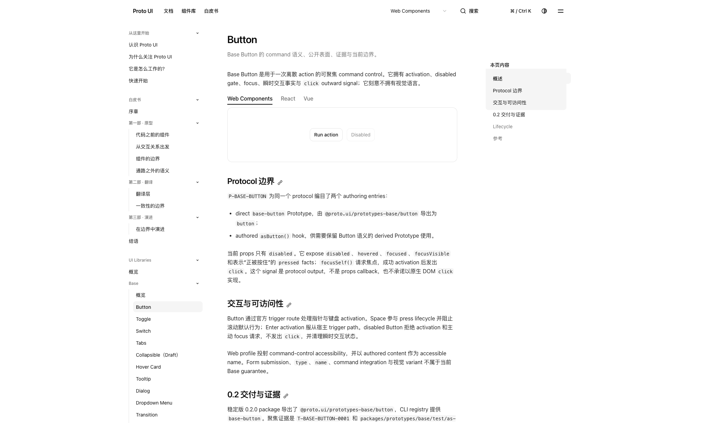
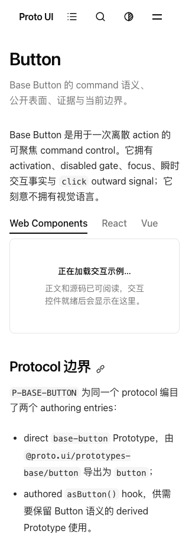
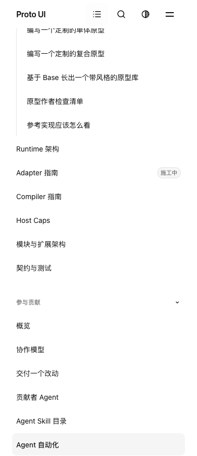
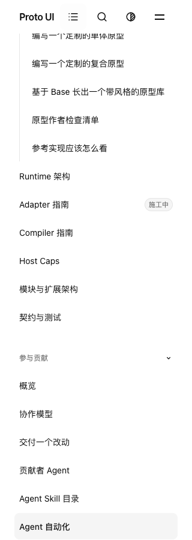

# Runtime-label fixture and Search observation supplement

This supplement binds `cf4848c49ad8849d45f03f3270b2ba78beffc7a2`, tree `d9fa302caf830f22fbde5bf6edb1852a8e39948e`. It adds two commits after the [8bfea main/sidebar checkpoint](../issue883-main-integration-8bfea320/README.md): `b1629e2a` corrects the Startup fixture's obsolete local Select target; `cf4848c4` adds bounded Search observation metadata. The four changed files are tests and a test-only helper. Application production source and the prior33 C paths remain unchanged. This is partial evidence, not formal approval or full C acceptance.

The Runtime-label fixture now uses the existing strict selected Runtime Tab/legacy-control helper. The original text wait, numerical predicates and deadlines remain; the label uses an explicit rendered-text Range, while control height/width and scrollWidth remain separate facts. A positive-height check prevents an empty Range from passing. The original upper/overflow checks still exclude320px. On the same complete8bfea production artifact, the untouched2048 case failed its original30s selector wait (1 failed/26 filtered); the precommit corrected fixture passed all four widths (4 passed/23 filtered). Those are historical8bfea application inputs and precommit probe sources, not finalCF executions.

Search records reasons/entry times from existing readiness samples and the existing Docs query's settlement state. Its original predicates,1000ms boundaries and inputs were not relaxed. The first observer could let an observation-side throw replace the matcher outcome; the retained source-derived injected-control shows two violations. The second observer guards only recording, preserving both original matcher outcomes in two controls. This is not evidence of a real browser recording exception. Both unit epochs have129 passes; the v1 native30 pass and v2 types remain tied to their actual precommit sources. Observation cost and chained-Promise settlement remain real; no zero-interference or Search root-cause claim is made.

Actual cleanCF local results:

| Run                   | Passed | Failed | Filtered | Exit |
| --------------------- | -----: | -----: | -------: | ---: |
| final-cf-node147      |   2085 |      4 |        0 |    1 |
| final-cf-native176    |    175 |      1 |        0 |    1 |
| final-cf-portal16     |     16 |      0 |        0 |    0 |
| final-cf-production27 |     27 |      0 |        0 |    0 |

The Node four negatives remain the original Checkbox token predicates. The native176 failure is the docs-navigation case at1339, a30s wait for an enhanced current anchor; the separate sidebar nearest-edge/manual-scroll case passed. One later private failure-observation control passed1/9 filtered through all four configurations, so its failure catch produced no missing-state evidence. It does not close the original175/1 failure or establish a cache/cause. The first control wrapper attempt executed0 cases because its output directory already existed; that setup failure is retained. Original source and project preference bytes/mode were restored.

The current completeCF production artifact12414661477 is a new21145632-byte Actions ZIP, SHA `d71dba7aabdd6f3885a49b8cb0b2eb44c8c0edb7580766d5969ca78f34014bb0`, with3837 files/104068336 expanded bytes. Its binding artifact12414625755 names CF. The existing default generated-artifact admission recorded1 pass, using the same ZIP's full extraction as its source directory; this is not an independently built local producer. The retained comparison shows many file hashes differ from8bfea, so source equality must not be turned into artifact/environment byte equality. The actual final production27 test used the complete currentCF site, not a page subset. Full ZIP/site/cache remain privately retained and are not mirrored here.

Current CF canonical main run39751754024 completed with22 jobs:12 success /10 failure. Actual synthetic checkoutdf44 has parentsb928+CF and tree d9fa exactly equal to the source commit. Only complete shards1/4/5 provide a subtotal:437 passed /17 failed /15 skipped. Shards2/7/8 retain deadline exit124 without complete summaries; shards3/6 failed in the3-minute CJK-font setup and never entered Vitest. No all-eight test total is constructed.

The dedicated Search job failed its5-minute dependency/font setup with0 executed tests. New observation fields came from main-shard1 Search28/2, not that job: one initial-ready failure recorded seven active-query points from stage+966 through+1006ms, all count0, with null disabled/owner/generation and no dropped samples. These points do not describe the unobserved first966ms. The other failure was the Docs Shadcn2048 original single query still pending at the+1001ms frozen verdict, without a returned role/error. Neither observation justifies a deadline change or establishes a production/scheduling cause.

Current CF Startup passed27/27; historical baseline48b passed27 separately. Dialog candidate8 passed and its historical accepted7-geometry/1-not-offered baseline remains distinct. Portal's dedicated job failed font setup. Main/special NativeLinks10, Header16, Shadow111 and Collapsible36 were observed passing, without promoting their incomplete containing shards to success. Homepage remains8/1: the Brutalist poll rejected at1001.416ms and its third query returned at1124.795ms; the bounded drain completed in123.178ms. A late return does not rewrite the original red.

Canonical types reported937/0 errors/0 warnings/14 hints. General stopped at78 public-doc drift findings before Vitest, so owner17 and the four token checks were not executed there. Package logs contain45 build records among47 configured packages,47 manifests and9 policy tests, with4 PASS/5 ADVISORY measurements. Its actual Node24.22.0/zlib1.3.2.1-motley-285e94b is not the old8b environment even though nine measured gzip/minified/hash rows match. These source-bound terminal results remain partial / ABSTAIN, not full C acceptance or formal approval.

`evidence.zip` contains 248 mapped original sources and 230 unique members including the map. Equal repeated tracked source censuses are stored once, while every original receipt/census keeps its own raw hash mapping. These censuses contain public repository-relative filenames and hashes, not file contents or private operational contexts; they are not measured dependency closures. Text/scripts/logs are declared sanitized derivatives and are not the original execution bytes or standalone runnable code. PNGs are unchanged.

Five actualCF viewport images were reviewed, plus two earlier precommit Startup frames retained separately. At CF2048 the label and Action/Disabled buttons are visible; at CF320 the label is visible while DemoSkeleton is still pending. Neither captures all preview behavior. The three sidebar frames show the separate passing sidebar case and do not replace the missing1339 failure capture. No all-frame/full-document/AT or remotely verified intranet claim is made. Private model/context/handoff/authorization data, preference backups, credentials and browser binaries are excluded.

