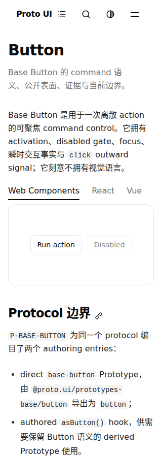
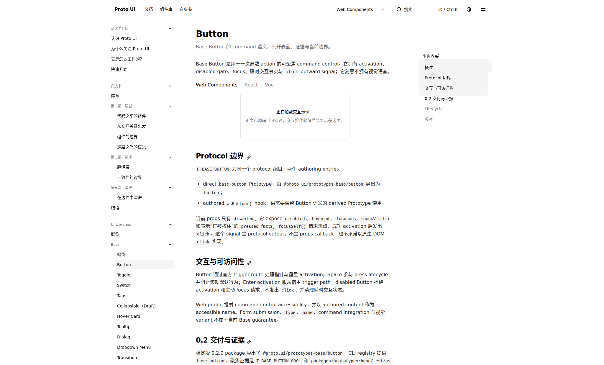
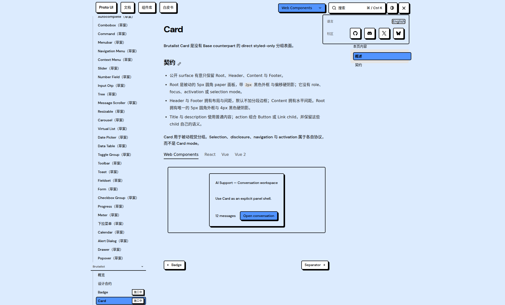
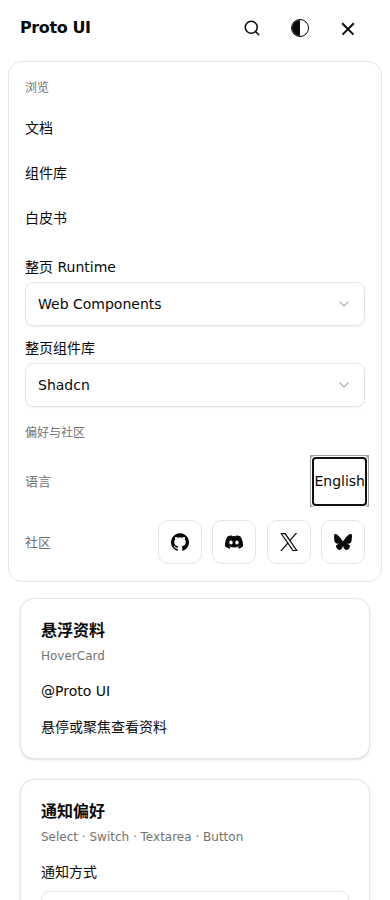

# PR #921 C progress: d67b16fc

Source head: `d67b16fcea924538ca9c58829955084ad208f488`  
Source tree: `f1e37c12ee9546a31b65b1e4e929bf1059f793a9`

This is a progress packet with completed selected local executions and a nonterminal canonical CI observation. It is not an all-green result, formal approval, optical admission or permission to merge. The four remaining local Checkbox token failures and five strict-budget overruns remain visible.

## Changes and actual results

The four new commits correct the Dialog geometry reader's renderer-owned portal shape, retain bounded post-verdict Docs role observations, wait for physical WC retirement before the fixture's original reopen, and consume the existing contact paint-outset helper through the existing public material subpath. The last change adds one narrow export; it does not change the formula, shader, sink, package subpaths or strict packed source wall. The material entities remain draft. Original assertions, case deadlines and keyboard-owner controls are retained.

Exact clean d67: Node147 has 2,085 passed / 4 failed across 147 files; all 17 keyboard-owner controls remain. The six complete native files passed 177/177 and the two additional Portal files passed 16/16. Before/after tracked-source censuses are identical for each run. These finite local results do not close the four token failures or prove all repository tests green.

Official main CI was observed 2026-10-22T12:08:18.312563+00:00–2026-10-22T12:09:41.326151+00:00 (non-atomic): status `queued`, 21 created jobs, 9 success / 1 failure / 2 running / 9 queued. This is not a final plan or test total; unexecuted tests remain unassessed.

The precommit three-file material candidate was built through the real generator: 47/47 packages and 47 manifests; the same original packed command changed from rejecting two public source files to zero public source inputs. Five focused files / 126 tests and types for 937 files (0 errors, 0 warnings, 14 hints) passed. These are saved precommit bytes individually bound to the signed d67 commit. The clean d67 emitted-export check is a separate ESM import smoke, not an extra Vitest test. Nine actual whole-entry measurements have four within and five over historical strict ceilings; the existing Finf development policy makes them advisory. No ceiling was changed.

The original CF Search record contains a 1,073ms browser long task overlapping about 782.8ms of its original 1,000ms stage under the stated shared-clock assumption. About 183.2ms remains unassigned; a later CPU profile is not that task's stack. Brutalist's third original getter itself occurred after poll rejection. The Docs observer supplies bounded evidence, not a production root-cause repair. Offline controls use fake matcher/getter/logger and are not native acceptance. Original failures and injected controls retain their own source/time/scheduling boundaries.

## Complete production artifact and actual frames

Official current production run 39773465363/job 119806472610 retained all 3,837 files and 104,067,496 expanded bytes. The full Actions ZIP is 21,143,788 bytes, SHA256 `c64349d44e34c6f3c0f320bb009efc7876811b63027d43e61df2cb8fa2168399`. Local original default admission passed against the entire ZIP and its complete extraction; this source comparison is not an independent precompression tree. The producer separately passed its original admission with its own 21,208,084-byte test ZIP. No pages/resources were trimmed. Whole ZIPs and extracted sites are retained privately, while metadata, full indices, checks and hashes are selected here.

Official current Startup candidate run 39773465567/job 119806472199 passed 27/27. Its original artifact records revision d67, baseline false and Chrome 155.0.8059.39. Local native tests used locked Playwright 1.58.2/Chrome 145 on macOS, with the project toolbar preference restored exactly afterward; the environments are not claimed identical.

Root viewed all seven selected original PNG files across their actual epochs (six unique hashes). Four are current d67 frames. The 320px Button frame shows actual controls. The 2048px runtime-label frame still has a loading DemoBox and is not a fully-ready preview claim. Loaded Card and Homepage are separate actual captures; the narrow page continues below the viewport. Images are copied byte-for-byte without editing or re-encoding. Other downloaded images are not selected.

Current original preview frames and their timing limits

## Provenance and remaining work

CF to d67 changes six paths. Of the original C33, 32 retain exact mode/type/blobs; the scene has only its reviewed import migration, and restoring those imports restores the entire previous file. No lifecycle activation, Compiler/IR/CLI takeover or new task claim is made. Peer reviews are partial / ABSTAIN, not GitHub approvals.

The current popup-boundaries job's calibration failed 186/1 because the QA shard inventory omits manifest family `input` (21 versus 22). The target contrast probe and popup journey were skipped; it is not a demonstrated Dialog/Portal behavior failure. Current browser 7/8 job 119809231470 failed its 3-minute CJK-font installation step before the target browser command; its synthetic checkout tree equals d67, but no browser tests executed. This is not a demonstrated C predicate failure. Historical f590 General's 78 documentation-classification findings, native-window-blur precondition and TOC-motion failures remain separate. Pending exact-head canonical results require a later append and the existing independent review/CI gates.

The archive selects 245 raw inputs and 46 census hash references. `PUBLIC-MAPPING.json`/`public-map.json` bind every selected raw digest to its public derivative, with omissions and path aliases declared. Sanitized source/logs are evidence derivatives, not the original executed bytes or independently runnable copies. Large census bodies are hash-reference-only and are not a full dependency/bundle closure. Attribution samples, private context, authorization/handoffs and private preference originals are excluded. No CI rerun/cancel, approval, merge or release was performed.
