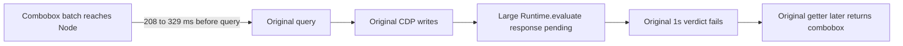

# Same-head hosted C failure follow-up

This later supplement preserves the real failing canonical observations for product head `1a66399f9bb593717e4b9b70ac4bc0ec36fc510f`. The fetched synthetic checkout `b670e5872a6e13c3fda248939aee1c4614e4a930` has parents main357 and product1a, with the identical tree `6e56e93b71b51f18957aa7053088ec95e358b624`. Tree identity does not make CI and local environments or results interchangeable. The earlier core capsule remains unchanged, including its explicitly dated08:35 CI snapshot.

The complete later metadata window is08:53:33–08:54:04UTC:86 checks=40 success/22 failure/14 queued/6 in progress/4 skipped, with20 runs. The main CI is not all terminal or green; public_package_build remains skipped. The maintainer's08:44:28 edit acknowledges the source-level100MiB capacity concern is addressed, while expressly withholding formal approval/full CI/native/merge clearance. Exact-head canonical preview separately passed its original complete100MiB admission; it does not close these failures.

The three terminal job logs establish distinct outcomes:

- General121119530668 stops at78 public-docs classification findings before ordinary Vitest. Its separate media precheck passes15/15.
- Browser2/121119530681 exits124 at the original900s limit, without a whole-shard summary. Search's completed file is13 pass/17 fail:8 initial readiness and9 original1s Docs role cases. A later Demo Matrix committed-host predicate also fails its original60s.
- Browser3/121119530677 completes11 files/96 tests:92 pass/4 fail. Brutalist family poll fails its original1s, paint fails the first native trigger's30s click before screenshot, and two projection-family disabled-opacity cases observe1 rather than0.5. The Dialog case passes1/1. Names alone do not assign root causes or ownership.

We read two existing source-bound artifact ZIPs: shard2 ID12592879020/19,163,138 bytes and shard3 ID12592468256/67,269,644 bytes, verifying their metadata SHA256. Only52 selected original JSON members and one later explicitly viewed PNG are projected here. No CPU profiles or unviewed image bodies are extracted/published. The original JSON-only selection receipt predates the separate visual selection; original records are not rewritten. Initial log-only reports retain their earlier not-downloaded/not-fetched boundary, resolved by later download/Git-object receipts.

## Actual Docs failure boundary

All9 failed original verdicts occur while the first large injected-script Runtime.evaluate has no Node response. The same Node clock already received the first combobox observation batch208.497–328.845ms before querying. The target observation is not a physical first-paint timestamp or proof of persistent node identity. Later original getters all return combobox; their returns are235.012–1160.162ms after the frozen verdict. The one Brutalist390 positive remains separate.

| Observed interval in the nine failed cases     |               Range |
| ---------------------------------------------- | ------------------: |
| First large evaluate: Node send to response    | 1218.158–2099.348ms |
| Transport-before to last write return          |       1.169–3.531ms |
| Last write return to response-completing chunk | 1214.506–2097.593ms |
| Frame scheduler-call to callback               |     0.0238–0.0563ms |

Eight failures have corresponding whole-stream drain observations0.542–3.564ms after the last write; Brutalist1440's writes return true and emit no corresponding drain, so no zero is invented. Stream drain is not command ACK, and whole-frame completion is not first response byte. The remaining interval includes unmeasured browser receipt, scheduling and engine work. It cannot be renamed pure compilation, execution or transport.

Eight initial readiness failures are different: their sole original browser sample sees0 exact targets and null getter times, with browser entry observed17–1243ms after the nominal deadline. First exact-target/fully-ready observer delivery is69–1405ms late. These are bounded source observations under the original epoch convention, not continuous physical absence or a transport root-cause proof.

## Same-case Brutalist family

Three post-verdict RPC brackets admit a conditional Node-minus-browser offset intersection117341.779462–117346.338399ms. Under a fixed-offset/equal-rate approximation, the dataset write occurs145.759–150.418ms before observed rejection; MO delivery11.559–16.118ms before it; the third utility read184.282–188.841ms after it. The nominal start+1000 deadline is0.396122ms earlier than observed rejection. This is not complete drift calibration or physical-paint measurement.

The third query is call@2044→attempt1→Runtime.callFunctionOn7873. Injected/utility script caches already exist. Send-before→response is801.213969ms, local send-return0.155720ms and frame queued→callback0.466498ms. The real third call returnsBrutalist190.015ms after rejection. getterNative=false records an existing utility wrapper; a same-tick read is not pure zero-cost native execution. These facts distinguish an in-window observed application write from a late observed getter, without naming the unmeasured cause. Original assertions remain red.

The selected390×844 image shows the actual post-failure menu already styled/selectedBrutalist. Root viewed its original bytes. It was captured after the original deadline and late query, so it does not prove that frame existed at the deadline or close the failure. No new native run, source patch, timeout change or CI rerun was performed for this supplement.

Disposition is partial/ABSTAIN. Local green controls, historical main718 and oldc5 paint's screenshot wait are not assigned to these actual hosted failures. Source repair is withheld where the evidence does not identify a justified implementation change.
