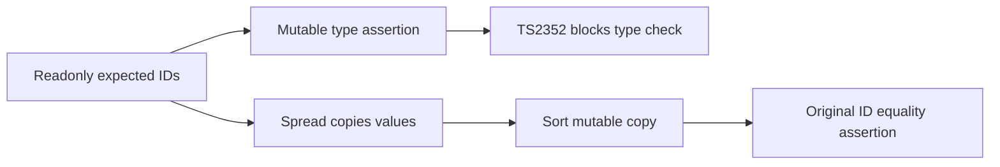

# Readonly registration expectation type repair

Source commit `c73a98117e1c92aa16b2743023b035f00dfc73b8`, parent main `7969265c2104464acac2ac761b46906e7570f320`, tree `7f26137ca26672ad85b74c648c42d7064f937dd1`. Five existing registration tests change one expression each. Expected ID tuples, equality assertions, input data and deadlines are unchanged.

The red full type check was executed on the main+Contents combination `db909f378c978aae024b5658631208dfb031c6a5`, whose five errored files are byte-identical to main. It reports five TS2352 errors: readonly tuple assertions to mutable string arrays. This is not a claim that a separate pure-main type command ran. The repair copies the tuple directly before sorting and preserves the same emitted test JavaScript.

Actual source-bound validation: five original files,86/86 tests; full check:types exit0,1138 Astro files,zero errors/zero warnings/24 hints. Existing esbuild ES2024 target warnings in the focused run remain in its log. All five old/new TypeScript programs were independently transpiled with esbuild0.25.12 and their emitted JavaScript compared byte-for-byte equal. These are precommit executions whose source bytes match the final commit; no new UI/native/package-build evidence is claimed.

The logs and Vitest JSON retain failures/hints. Absolute machine source paths in published text use explicit placeholders; raw-public-map.json binds original and public hashes. A derived public report is not the raw executed report. The final source binding is separately readable. No catalog, lifecycle, product, matcher or timeout changed. New exact-head CI and independent maintainer review remain pending. AI assistance: Codex, human-assisted/current-user; local independent review partial/ABSTAIN.
