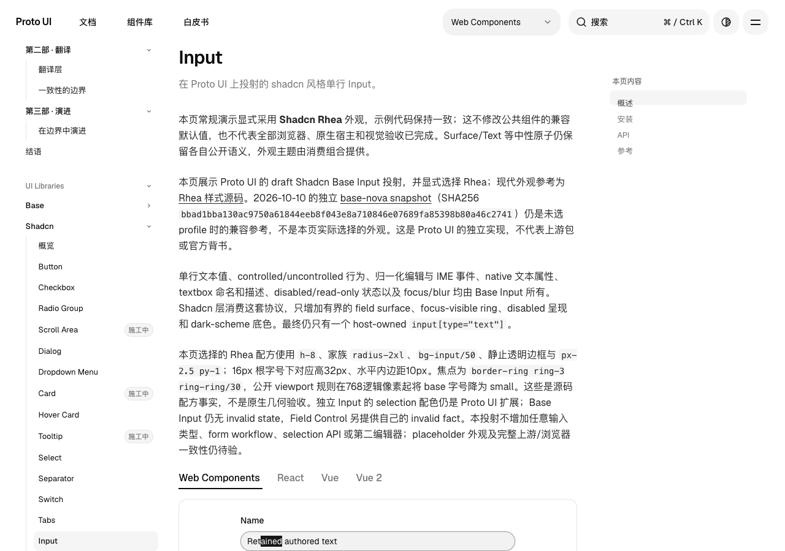
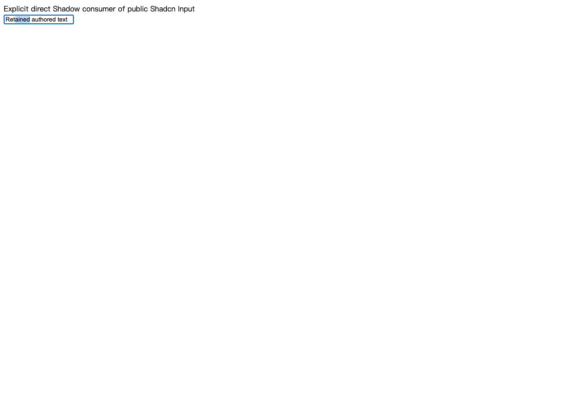

# Distinguish connected blur from native transport; preserve descendant focus

Agent request paraphrase: continue the authorized PR #1494 Website repairs and current review feedback, preserve content/assertions/deadlines, retain real failures and verify the exact source and packed candidate before reporting acceptance.

Candidate `22e90bc7cec5f59303c93d07fc4497c52a9156ce`, tree `bedac43346f5d4857247c2ee8af67998e8e340d3`, parent `a0f5a03e01c8bde328aa167a5b5a98eaa20b4cf8`, on main `0f0955a9d624e0ef5e250f56a0eaa0fc52bbfb53`. Five signed/DCO commits still change only the private Website native-content-lease source and its unit tests. Applicable projection and Text Control entities remain draft; no public API, Adapter identity or lifecycle change.

## Current review questions

- [Connected blur r4604840808](https://github.com/Proto-UI/Proto-UI/pull/1494#discussion_r4604840808): a callback can blur a still-connected shadow control without focusing another element; a focusin-only guard cannot observe that choice.
- [Descendant focus r4604840821](https://github.com/Proto-UI/Proto-UI/pull/1494#discussion_r4604840821): a newly focused inner control's composed path includes its original host. Ancestor membership does not mean the same deep target still owns focus.

The candidate compares the exact deepest active element, rather than membership in a focusin path. For blur, a temporary child-list observer records removals after the observed connected focusout. Removing one of that event's ancestors supplies the physical-transport witness; without that witness the old focus/range lease is revoked. It observes the scope parent and crossed open Shadow roots, and disconnects with its focus listeners in `finally`. The current producer performs one native `insertBefore`.

**Bounded limitation:** a deliberately authored blur followed by a later transport removal in the same opaque callback can expose the same browser event/mutation sequence as transport itself. This implementation does not claim universal author-intent inference for indistinguishable callback sequences or introduce a new public signaling API. It covers the current producer and the explicitly tested callback boundaries below.

## Same-run event and mutation evidence

A separate observing source run uses the same compiled helper bundle, with an independent observer queue and capture listeners. It records four modes and both variants: eight rows, two retained a0f failures, all four candidate controls pass. This additional observer run is distinct from the uninstrumented functional matrix; it does not establish performance, hosted scheduling, or correspondence with Node clocks.

| Candidate control | Actual event order | Outcome |
| --- | --- | --- |
| Native move to another parent | focusout: connected=true, active body, no preceding removal; later focusin: original field and a pending removal of source from old parent | native field/range restored |
| Connected blur with no move | focusout: connected=true, no removal; no later input focusin | body remains active |
| Native same-parent reinsert | focusout: connected=true; later focusin has removal and insertion of the same source, despite unchanged final ancestry | field/range restored |
| Callback focuses inner control from original host | focusout path names the host; later focusin path contains both the inner field and that same host | exact inner field remains active with its 1–4 backward range |

These observations explain why the earlier connected-focusout-only guard was invalid and why final ancestry alone is insufficient for same-parent reinsertion. `focus-timing-control.mjs.txt` retains the actual additional observer bytes and full event rows are in `measurements.json`. Native events here result from programmatic focus/blur and DOM transport; `isTrusted=true` is not presented as trusted keyboard input.

## Red/green and exact-head combination

- The same four final unit cases on a0f give **4 failures / 24 passes**. The exact candidate gives **268 passes across six focused suites**; earlier selection/range/shadow/focus-owner controls remain.
- Same final native observer on a0f on both sides: 54 rows with six expected failures. Candidate source and actual emitted-module runs: **27/27 modes pass in each**, retaining three a0f failures (connected input blur, connected textarea blur, host-to-descendant focus). The extra same-parent light/shadow controls pass on both versions. No original assertion was weakened.
- Fresh workspace types exit 0; actual Website build **685 pages** with the two disposable draft-route overlays restored. Fresh artifact inventory has **1,268 roots in each locale**; public article **9/9 CodeExample** entries retained.
- Actual packed Contents/Dialog/Runtime Tabs: **11 tests passed**, 13 filtered, original deadlines intact. Header trusted-family first-frame geometry passes at 320/390 px; geometry sampling can force layout.
- Actual public Shadcn Input **Light default** and separate actual public-package Input with explicit **shadow:true** each preserve same native field, focus, value and 3–8 backward range immediately and after two animation frames, for both a0f baseline and current emitted helper. They are positive regression controls, not new red baselines. The explicit Shadow fixture does not import document CSS and is not a full RuntimeBox family-switch or family-appearance acceptance.
- Node24.21.0/pnpm10.32.1/Chrome156.0.8078.79 on macOS arm64. Actual observer, source, served-module, artifact and image bytes are bound in the JSON. The two public observer scripts and unchanged explicit package consumer are bound to their prior public source; their actual new executions are recorded here.

These unedited 1280×900 light-preference captures were individually inspected. The default Light field is near the viewport bottom; the full page and all resources remain. The direct Shadow fixture's plain native appearance is deliberate evidence scope, not a new visual-conformance claim.

## History and remaining acceptance

The preceding [shadow/focus packet](https://github.com/HyacinthHaru/Proto-UI/tree/605f47472e856093b1c86f21f9d5e925da63c455/evidence/2026-11-17/native-text-selection-shadow-focus-review) preserves the real explicit-Shadow failure/fix, default-Light premise correction, rejected connected-focusout guard with 12 native regressions, failed metadata wrapper, and callback focus controls. It links the earlier native-caret and callback-range packets; no old failure is relabeled or deleted.

47-package build, manifest and 3 PASS / 6 ADVISORY budgets remain explicitly reused e977 local evidence because package/config/lockfile/manifests are unchanged. These are not new-head package execution or canonical hosted measurements. Full bilingual S4 startup last failed at e977 under its original 60 s readiness / 150 s case limits before Dialog; it was not repeated for these focus-only deltas and is not a current full pass.

Evidence disposition: **partial**. Executed script bytes and complete native state rows are retained; unit/process reports are summarized with raw hashes and failed-case identities. No closed Shadow, all-browser, full family-switch, new visual-design, hosted full-regression, independent maintainer approval, thread resolution, merge or release is asserted. Continue current exact-head independent recheck, real thread disposition and the separate S4 startup work.
