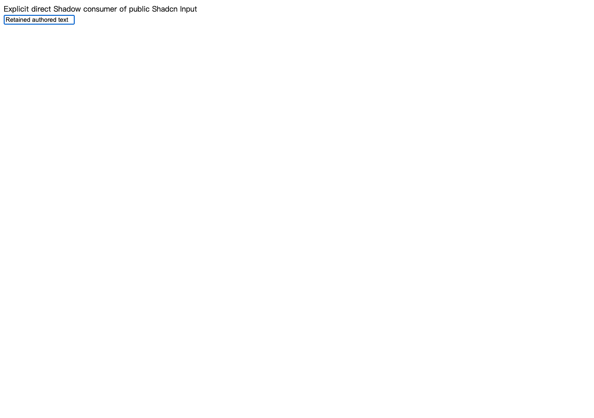
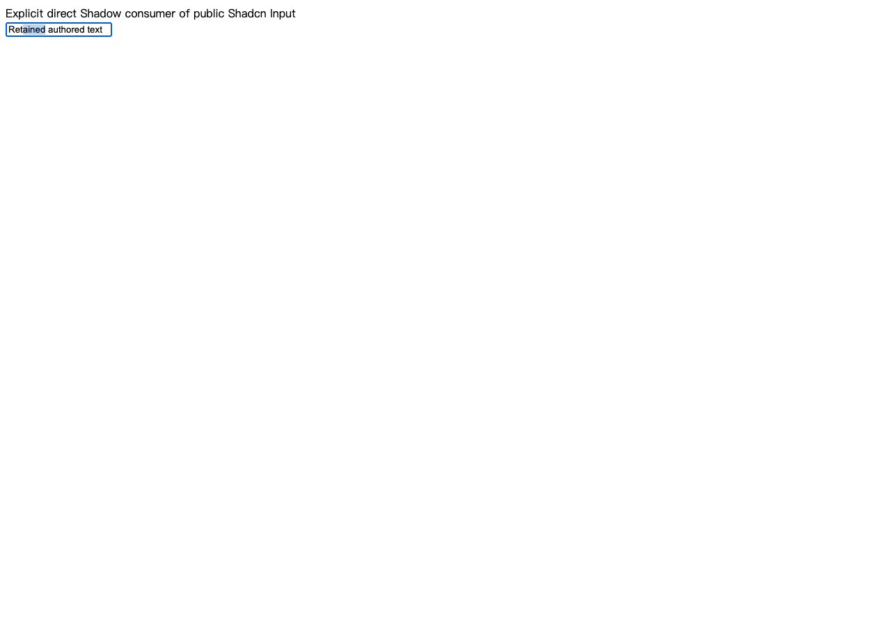
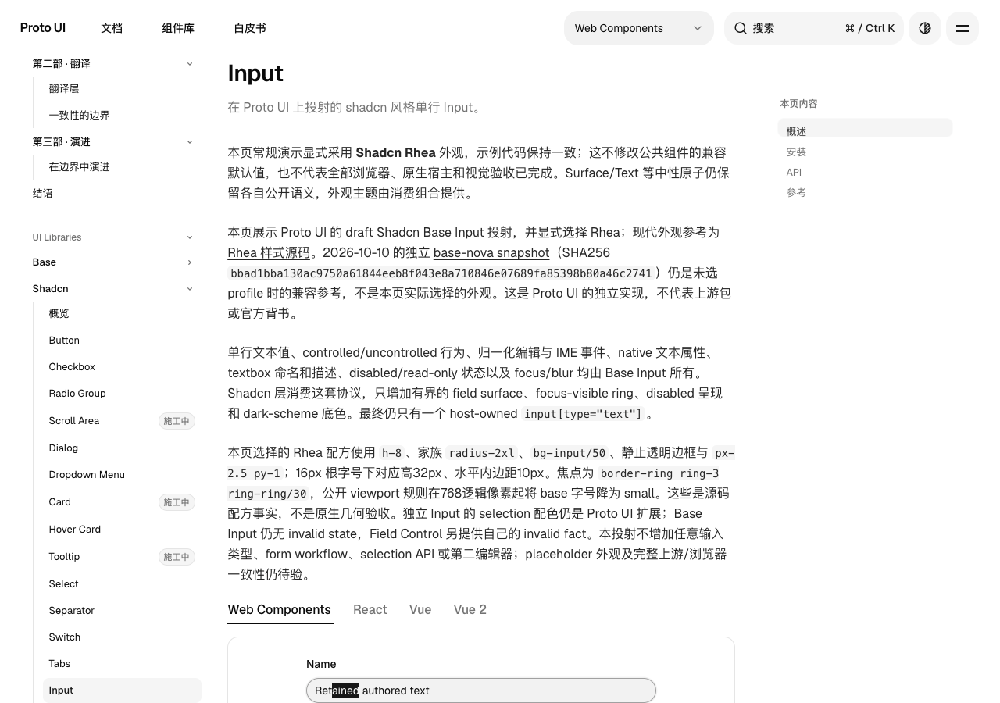

# Website native Selection: open Shadow and callback focus ownership

Agent request paraphrase: continue authorized Website regression repairs and valid PR feedback, retain all page content and original assertions/deadlines, verify source and packed consumers, then report precise acceptance and remaining work.

PR #1494, final candidate in this packet: `a0f5a03e01c8bde328aa167a5b5a98eaa20b4cf8`, tree `b5721270ef2389b4bfe6b3cc2bcadacb272a5f17`, parent `4e58cc582abcc06cf084b5bec01620153b9ae606`. All four PR commits are signed by the same responsible contributor with DCO; two Website source/test paths differ from main `0f0955a9d624e0ef5e250f56a0eaa0fc52bbfb53`. No package, public API or lifecycle change. The Website projection and Shadow profile decisions retain their actual draft lifecycle.

## Correct the profile premise

[Review r4604446509](https://github.com/Proto-UI/Proto-UI/pull/1494#discussion_r4604446509) correctly identified the need to follow an active open-shadow chain, but its **default WC Shadow** premise does not match this source. [`normalizeShadowProfile`](https://github.com/Proto-UI/Proto-UI/blob/0f0955a9d624e0ef5e250f56a0eaa0fc52bbfb53/packages/adapters/web-component/src/shadow-profile.ts) returns false for omitted/false; `wc-registry` omits the option. `A-WEB-COMPONENT` and `D-WEB-COMPONENT-SHADOW-PROFILE-0001` separately preserve Light and explicit direct Shadow profiles.

The first public Input probe incorrectly required a shadow root and failed that fixture precondition before measuring either variant. Its script and failure disposition are retained. The corrected public Shadcn Input route actually reports **Light** and succeeds with both the previous and candidate helpers after a direct preview-host move, immediately and after two animation frames.

A separate consumer imports the actual built public `AdaptToWebComponent` and `shadcnInputRoot` exports, explicitly passes `shadow:true`, and mounts in a synthetic same-origin native host fixture. It uses the actual emitted Website lease module for the candidate. This is an explicit supported direct-Shadow consumer control, not the Website default or a full RuntimeBox family-switch journey. Document CSS is not imported into this direct Shadow fixture; its plain native appearance is not a family visual-conformance claim.

## Shadow repair at 4e58cc58

The helper now follows `shadowRoot.activeElement` for both capture and restoration, and crosses `ShadowRoot.host` when checking retained-scope ownership. The four added input/textarea original/focus-callback cases fail on 0eca with 16 other unit cases passing; 4e gives 260 focused passes. Its source and actual emitted-module observers each run 18 candidate modes, all pass, while retaining four baseline shadow failures.

Actual public-package direct-Shadow result, website/consumer artifacts held constant:

| Phase | 0eca helper | 4e emitted helper |
| --- | --- | --- |
| Initial focused native field | same field/value, 3–8 backward | same |
| Immediately after physical host move | same field/focus/value, 0–0 forward | same field/focus/value, 3–8 backward |
| Two animation frames later | 0–0 forward | 3–8 backward |

These unedited 1280×900 captures show the actual packed Input consumer under light color preference. The surrounding fixture label identifies its explicit profile; the variable rows carry exact endpoints and direction.

## Callback focus precedence at a0f5a03e

[Review r4604631815](https://github.com/Proto-UI/Proto-UI/pull/1494#discussion_r4604631815) then exposed a real new boundary: deepest focus recovery could overwrite another control selected synchronously by a move callback. The repair observes actual different `focusin` ownership throughout move, refocus and range restoration. That revokes the original focus/range replay, including when the new owner subsequently blurs. Its temporary listener is removed in `finally`.

The final four input/textarea × other-focus/other-focus-then-blur cases give **4 failures / 20 passes** on 4e. At the candidate, all six focused suites give **264 passes**. A source control comparing 4e on both sides has 44 rows and eight expected failures; final source and emitted-module runs each retain four baseline failures while all **22 candidate modes pass**. The prior light/shadow ranges, callback-selected ranges, page/cross-owner and registered-wrapper Selection checks remain green.

| Callback result before helper restoration | 4e helper result | a0f helper result |
| --- | --- | --- |
| Another field receives focus and a 1–4 backward selection | original inner input reacquires focus | new field keeps focus, value and 1–4 backward selection |
| Another field receives focus, then blurs | original inner input reacquires focus | body remains the focus fallback; original input is not reacquired |

### Rejected connected-blur guard

The first attempted guard copied an adapter-specific connected-`focusout` heuristic. It passed 264 unit tests but **regressed 12 candidate native field cases**: in Chrome an ordinary `insertBefore` transport can deliver `focusout` while the original field is still connected. That predicate cannot distinguish transport from author blur here. The uncommitted attempted source, exact observer, measured native failures and original unit summaries are retained.

The original unit transport ordering and value/range assertions were restored. Final coverage protects an observed new focus owner and new-owner-then-blur. It **does not claim to distinguish a lone author `blur()` from identical transport-induced loss inside the opaque move callback**. The earlier broader blur-only assumption is not relabeled as fixed or as a successful product run.

## Fresh exact-head combination

- Node 24.21.0, pnpm 10.32.1, Chrome 156.0.8078.79, macOS arm64; source/observer/served-module hashes in `measurements.json`.
- Fresh workspace types exit 0; actual Website build 685 pages, temporary draft-route overlay restored. Fresh inventory retains all 1,268 roots in each locale.
- Actual packed Contents/Dialog/Runtime Tabs: 11 tests pass, 13 filtered. Original assertions/deadlines retained. Header trusted-family first-frame geometry at 320/390 px passes; those geometry reads can force layout. Public article retains 9/9 CodeExample entries.
- Final emitted helper passes all 22 native modes. Actual public Website **Light** Input and separate public-package **explicit direct Shadow** Input each retain the same native field, focus, value and 3–8 backward range immediately and after two frames, for both 4e baseline and a0f candidate. These are regression controls; they are not claimed as new baseline failures.
- Package source/config/lockfile/manifests remain unchanged. The 47-package build, manifest pass and 3 PASS / 6 ADVISORY measurements are explicitly prior local e977 evidence. Actual excesses and source identities remain recorded; there was no new package build or canonical hosted measurement for these Website-only deltas.
- Original full bilingual S4 startup failures are bound to e977, with the original 60 s readiness / 150 s case limits and all roots retained, before Dialog. That unchanged full startup suite was not rerun for these focus-only changes; there is no new-head full S4 pass.

Both actual 1280×900, light-preference captures were inspected. The Light page remains complete; its field is near the lower viewport edge. No pixels were edited or recoded. This is scoped functional/state evidence, not a new typography, theme, whole-page layout or visual-quality acceptance.

## Reproduction and disposition

The `.mjs.txt` files retain actual executed script bytes. Rename locally to `.mjs` to execute. Source/packed observer conventions are documented in the preceding [main packet](https://github.com/HyacinthHaru/Proto-UI/tree/38246f6abbc0f684304aba8d5f9577f8cec38a0f/evidence/2026-11-17/native-text-selection-main). `build-public-shadow.mjs.txt` and its bound literal entry describe the explicit public-package fixture. Its first metadata-wrapper attempt emitted the bundle but then tried to read the synthetic stdin filename as a file; that failed wrapper is retained separately, and the corrected binding distinguishes literal fixture from resolved package artifacts. Native rows are retained; unit/process reports are summarized with their original raw hashes and failed-case identities. Original local logs remain retained without claiming they are all uploaded verbatim.

Evidence disposition: **partial**. These are source/packed native host-state controls and selected product regressions. No closed Shadow, full family-switch journey, all-browser, hosted full regression, independent maintainer approval, review-thread resolution, merge or release is implied. Continue the exact-head independent recheck, actual remaining threads and the separate S4 startup diagnosis.
