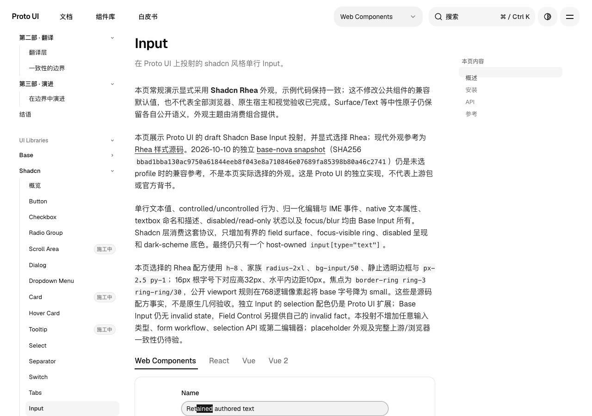
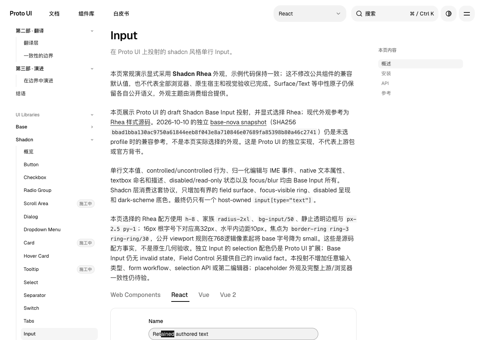
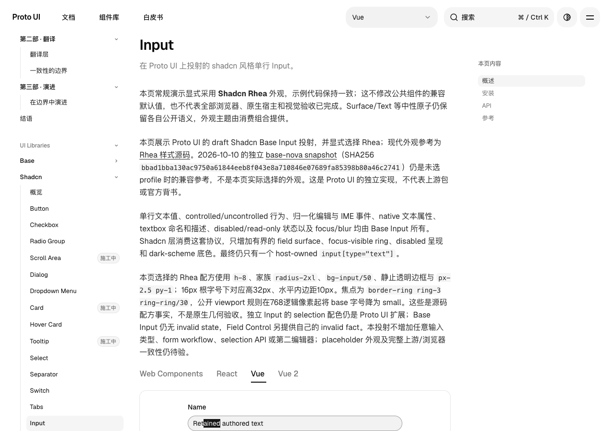
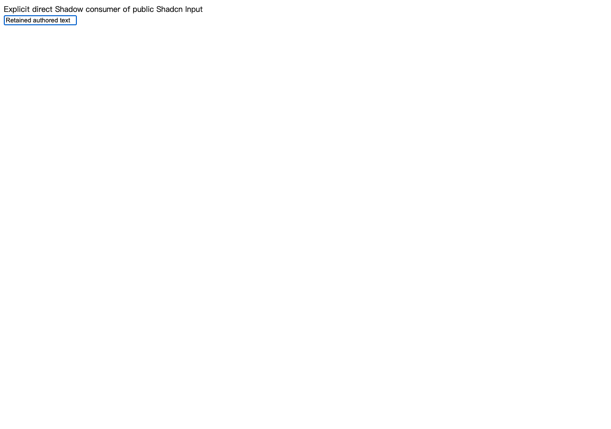
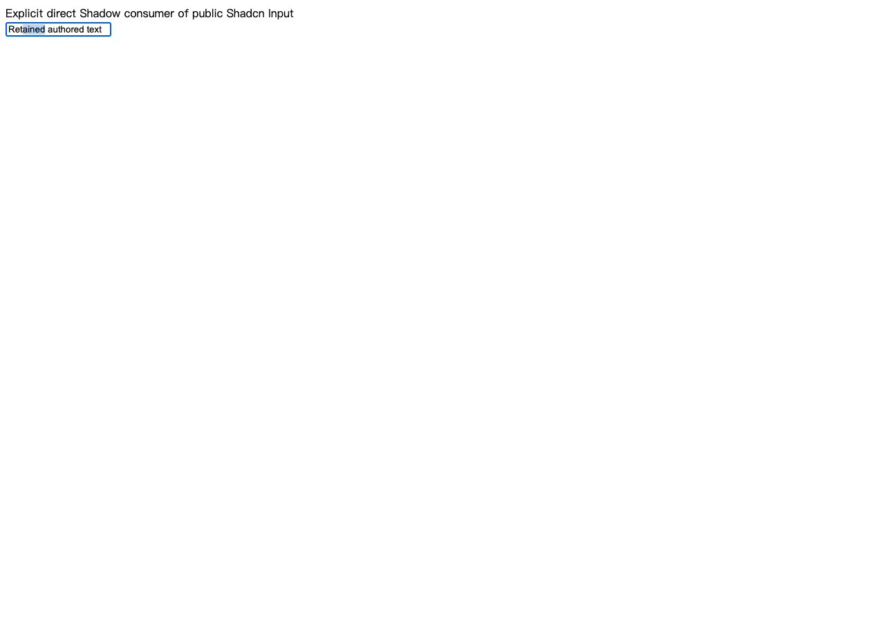

# Integrate reviewed native selection fixes into the broader S4 candidate

Agent request paraphrase: continue the authorized Website C-group work with complete pages/resources, original assertions and deadlines; combine current native-selection correctness with the retained S4 optimizations and verify the actual resulting source/packed composition.

Signed fork candidate `b6bfa4f0b978275dd2a2f0769fee19741c197459`, tree `dc207e9bf518274ced9aca313f6eff5095524a90`, is a non-rewriting merge with parents `ca3dff46432109bbe7a10b76ad19df4d5263ffb0` and `22e90bc7cec5f59303c93d07fc4497c52a9156ce`. It is published on the existing `codex/s4-text-selection-lease` fork branch, not merged upstream. PR #1494 remains the separate two-file main-based repair.

## Exact resolution

Only native-content-lease source/tests conflict. Every other tracked path remains identical to ca3. The resolved helper retains all current callback range/focus, open-shadow, blur/mutation and exact-descendant controls, plus S4's direct childNodes access, conditional endpoint capture and conditional boundary resolution. Its unit file retains all 28 main-candidate cases and the two existing S4 unrelated/crossing Selection scan controls.

The same final 30-case unit bytes on ca3 give **14 failures / 16 passes**. Six focused suites on the merged candidate give **270 passes**. Source-native old/old controls retain 26 failures across 54 rows; source and actual emitted-module candidate controls each pass **27/27 modes**, retaining 13 ca3 failures. These counts are the actual native scope and are separate from the unit scope. The evidence assembler initially assumed 14 native baseline failures, stopped, then corrected that count against unchanged raw JSON; it did not rerun or change source/assertions to fit a count.

The first setup wrapper tried to copy a fixture builder from a directory that retained only its output. It failed before any build/browser/test started; the actual retained builder was then used. Setup failure and subsequent real execution are separate.

## Fresh composition validation

Node24.21.0, pnpm10.32.1, Chrome156.0.8078.79, macOS arm64. New 47/47 public-package builds, manifests, workspace types and 685-page Website build completed. Both temporary internal draft-route build overlays were restored. All 1,268 roots per locale and the public article's 9/9 CodeExample entries remain.

All nine fresh local whole-entry gzip/minified/hash rows equal the earlier ca3 measurement. Policy result is **3 PASS / 6 ADVISORY**, with actual excesses retained; this is not a strict nine-entry pass or canonical hosted measurement. Recorded build environment includes zlib1.3.2.1-motley-8002e91 and esbuild0.25.12.

- Actual static preview: **11 Contents/Dialog/Runtime Tabs tests pass**, 13 filtered. Header trusted-family first-frame geometry at 320/390px passes; geometry reads can force layout.
- Actual public Shadcn Input: the real Runtime Tabs select **WC/React/Vue/Vue2**, and the existing committed-runtime getter is read. Each host runs ca3-helper and current-emitted-helper controls: **8/8 rows pass**, retaining the same native field, focus, uncontrolled value and 3–8 backward range immediately and after two animation frames. These are direct physical preview-host moves after real runtime selection, not full family-switch or hosted-shard acceptance.
- A fresh consumer of the actual newly built public Shadcn Input/Adapter explicitly uses `shadow:true`. On the same candidate package/Website artifacts, ca3 helper collapses the range to 0–0 forward while the merged emitted helper retains 3–8 backward. Field identity, focus and value remain; immediate and two-frame results agree. The Website default remains Light; this separate direct Shadow fixture does not import document CSS or establish family appearance conformance.

All six unedited 1280×900 light-preference captures were individually inspected. The field is near the lower viewport edge on the complete documentation page. The two helper variants use the same newly built consumer/page; the legacy variant is not represented as the old whole Website build. This is scoped functional evidence, not all accessibility, typography, family appearance or browser conformance.

## Full S4 still fails

The fresh original bilingual S4 suite has **0 pass / 2 fail** at `page.waitForFunction: Timeout60000ms exceeded`, before Dialog assertions. The original 150,000ms case limits and all 1,268 roots remain. Contexts close normally in this attempt. The late diagnostic journal query exhausts its original 2s observation budget in both cases; missing journal data is unknown, not an empty journal or a ready state. Streamed last-owner samples are earlier delivered observations, not proof of the precise missing owner at expiry.

The overall sequence remains failed because of those original cases. Narrowed public-page passes do not replace them.

## Discriminating content-visibility control, not adopted

The earlier local collector listened to `contentvisibilityautostatechanged`. Current [CSSWG editor's draft](https://drafts.csswg.org/css-contain-2/#content-visibility-auto-state-change) and [Chrome implementation guidance](https://developer.chrome.com/docs/modern-web-guidance/guides/performance/efficient-background-processing?hl=en) name `contentvisibilityautostatechange`; the old published 2022 draft used the older spelling. Current Chrome156 directly confirms the new handler property, event constructor and CSS feature support.

A paired single-Chinese-case probe keeps all 317 items/1,268 roots, the exact readiness predicate, 60s readiness timeout and 150s case limit. Both runs use the same observing runner/source; one keeps original emitted CSS and one appends only content-visibility:auto with an intrinsic block placeholder. No application semantic DOM update is skipped or removed by the script.

| Run | Actual delivered evidence | Original outcome |
| --- | --- | --- |
| Original CSS | linked exact asset; first/last item computed visible, intrinsic block none | readiness60s timeout |
| Disposable auto CSS | served asset hash bound; first/last computed auto and auto512px; trusted event checkpoint records 256 deliveries,255 skipped,1 rendered, old-name count0 at that point | readiness60s timeout |

The collector emits at power-of-two checkpoints; these are not final total event counts. Both runs have one selected case and one filtered English case. This demonstrates active render-skipping and a faulty earlier event subscription, but does not establish a throughput percentage or remove layout work as a possible bottleneck. The overlay stayed diagnostic and all CSS/test artifacts were restored byte-for-byte. It is not a production fix or altered acceptance workload.

The first new observer attempt accessed documentElement before it existed and stopped before registering listeners. Its actual page error/result and source are retained as invalid observation setup, not a new app failure or evidence of absent events. The corrected observer checks the available HTMLElement prototype; that repaired pair supplies the API/CSS observations above.

## Reproduction and remaining work

`native-control.mjs.txt`, `packed-control.mjs.txt` and public-consumer observer files retain their actual source bytes. The CV observer copies retain the TypeScript read by the instrumented runner; transpiled browser execution is evidenced by its emitted events. `cv-run-case.sh.txt` is a path-sanitized launcher template requiring TASK_STATE/toolchain inputs, not the exact original shell bytes or a standalone package. The measured runner/asset/source hashes, literal CSS overlay and setup dispositions are in `measurements.json`.

Evidence disposition: **partial**. This source-bound carrier is unassessed human-assisted partial/ABSTAIN, with no independent maintainer approval, upstream merge, hosted full CI, all-browser or release credit. PR #1494 source/evidence stay separate. Continue source-level startup attribution from the actual current candidate and preserve full S4 failures; do not substitute this failed CSS experiment or narrower green consumers for the original acceptance.
