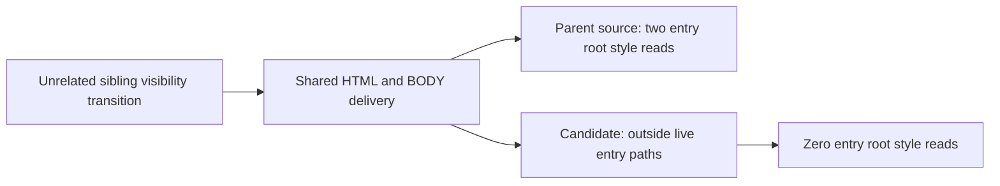

# WC entry transition origin: minimal main repair

Agent request paraphrase: continue authorized C-group repairs with complete content, original assertions and deadlines, real source/packed consumers and truthful remaining acceptance.

Exact candidate [`9427750cc760e092914087f2e88d365d115ccad9`](https://github.com/HyacinthHaru/Proto-UI/commit/9427750cc760e092914087f2e88d365d115ccad9), tree `e1c6217cffcd843906dd90681dbf5050c7d51c2f`, parent main `0f0955a9d624e0ef5e250f56a0eaa0fc52bbfb53`. One signed commit changes only WC runtime modules and seven focused regression cases. Existing SSH signature, responsible-author/committer identity, DCO and no coauthor checked; hook changed no tested bytes.

## Internal invalidation walkthrough

An actual CSS visibility transition in an unrelated sibling reaches Entry's HTML/BODY observers and previously caused two root computed-style reads. The candidate uses current entry/composed/Portal ancestry to filter that trusted transition, avoiding both reads. It retains synthetic notifications and broad external checked-radio/image-map observation. Current delegated moves, slotted ancestry and newly projected logical Portals before observer refresh remain covered. Draft Focus Entry/Scope and Host Capability lifecycle unchanged; no API, CSS cache, assertion, deadline or page-content change.

The native probe uses actual browser-generated trusted CSS transition events, not a forged isTrusted bit. Root reads are measured only during that dispatch and native field eligibility is checked afterward. This internal resampling repair has no intended pixel difference; the event/state table and executable source are the subject-appropriate walkthrough. It is not a visual-design or full-accessibility claim.

| Real transition control | Main parent installed consumer root reads | Candidate source / installed root reads |
| --- | --- | --- |
| Unrelated sibling | 2 (retained failing performance assertion) | 0 / 0 |
| Light descendant | 4 | 4 / 4 |
| Ancestor | 4 | 4 / 4 |
| Shadow-host/slotted descendant | 5 | 5 / 5 |
| Slot composed ancestor | 1 | 1 / 1 |
| External checked radio peer | 4 | 4 / 4 |

All six candidate modes pass in both source and installed-tarball runs; baseline unrelated-read failures remain. Synthetic same-Event reuse and new logical Portal before observer refresh are separate unit controls. HappyDOM supplies a disclosed native-bit branch and its missing assignedSlot fact; those unit injections are not presented as real UA events. Same final seven tests on main: **1 fail /6 pass**. Candidate **25 files /339 pass**, maxWorkers2/minWorkers1; actual tested source/test bytes equal the signed commit. This is not a count of unique tests across the other S4 branch.

## Source and genuine installed-package provenance

This small branch excludes the S4 branch's native-event WeakSet dedup, inline-style-load suppression, split-surface behavior and other80path work. The earlier [integration packet](https://github.com/HyacinthHaru/Proto-UI/tree/98329f695f9a3a65232a659dabbbe8f394ce8c09/evidence/2026-11-17/wc-entry-transition-origin) is a different source context and is not reused as exact-main acceptance.

Main's own old runtime was built and staged before the production patch, then the candidate was restored. The existing stagePackage helper creates **39 internal tarballs** for each side; each is installed outside the repository with scripts disabled and no package symlinks. Floating UI dom is pinned1.8.0; actual locks and tarball hashes are retained. Registry access is disclosed; no offline-install claim. Consumer builds disable tsconfig aliases. Each bundle has391input records, including its literal fixture: parent and installed candidate37WCdist/0WCsrc; source candidate37WCsrc with dependency dist. The earlier public-name/tsconfig alias mistake is not repeated or counted as packed validation.

## Fresh exact-head product and retained original failure

Node24.21.0/pnpm10.32.1/Chrome156.0.8078.79/esbuild0.25.12/macOSarm64, serialized heavyweight/browser jobs.

- Exact942 fresh **47/47 packages**, **685 Website pages**, manifests and full type check pass. Astro reports **1,240 files /0 errors /0 warnings /31 hints**, retained without suppression.
- Actual production preview: **11 Contents/Dialog/Runtime Tabs tests pass /13 filtered**, unchanged original1s assertions and deadlines. Header trusted-family first-frame geometry passes at320/390px; geometry reads can force layout. Article9/9CodeExample and1,268matrix roots perlocale retained. Disposable draft-route overlays were restored; no product route/content change.
- Nine measured budgets: **3 PASS /6 ADVISORY**, actual excesses retained. WC190516/132000gzip, over58516; minified656858, SHA5510cf696342b756cd7761c63017570578a14ab839075235646e4162d7b01dbd. No ceiling change or borrowed103byte S4 growth claim. Local measurement is not canonical hosted CI or strict-budget acceptance.
- Controlled main-parent runtime build: the actual branch HEAD was942, with onlyWCmodules temporarily restored to its exact0f blob. The new test file is not in the runtime artifact. Other tracked runtime source matches parent. This is explicitly a source-bound controlled build, not a false0fHEAD/CI claim; finally restored to the exact signed942source.
- That baseline and the exact candidate each execute both original bilingual S4 cases, **0 pass /2 fail on each side**, both with the original **150000ms case-deadline error** while the last journal remains startup-wait with empty hosts/startupPending. They are not relabeled as the other branch's60s waitForFunction failures. The separate earlier39package/installed baseline was also source-bound to main0f before the patch.

**Full S4 remains failed.** Same-stage old/new failure does not establish overall performance improvement or complete nonregression. Continue its startup/command-delivery diagnosis separately. No new #848 native run, hosted run, independent maintainer approval, thread resolution, merge or release is claimed.

Scripts/JSON are machine-path-sanitized derivatives with raw/public hashes and actual commands; reconstruct their task/toolchain inputs rather than treating them as byte-identical standalone original scripts. Actual source diff is `candidate.patch`. Complete native state rows and failed-assertion summaries are included; full local logs are retained by hashes, not all claimed uploaded verbatim. Source and receipt origins remain explicit. Disposition: **partial technical evidence, ready for independent review of the bounded repair; upstream acceptance pending**.
