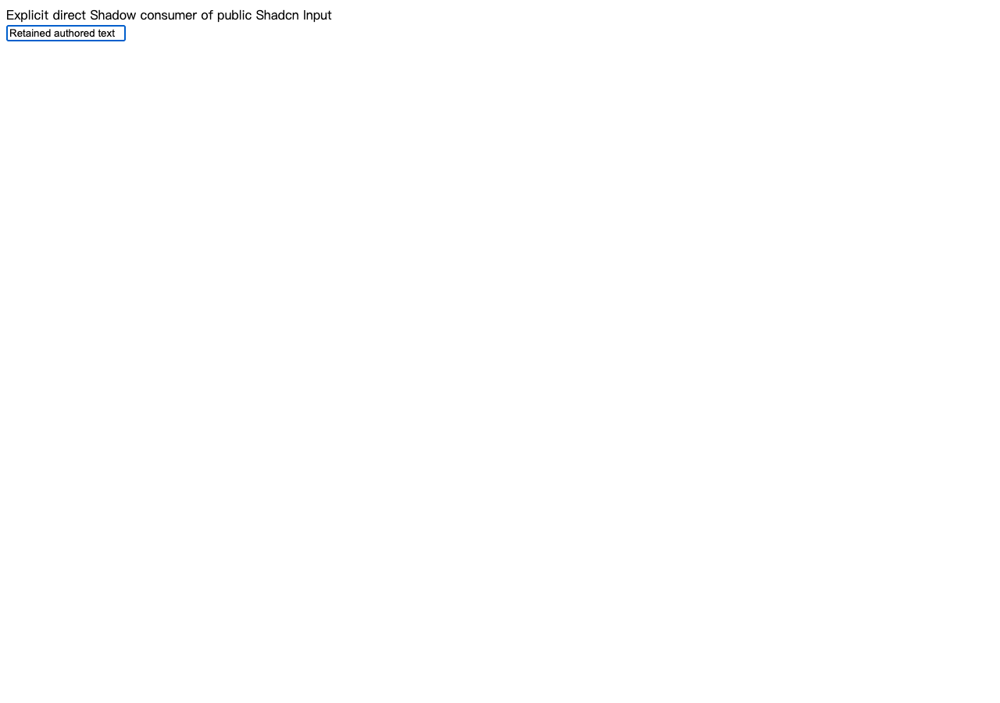
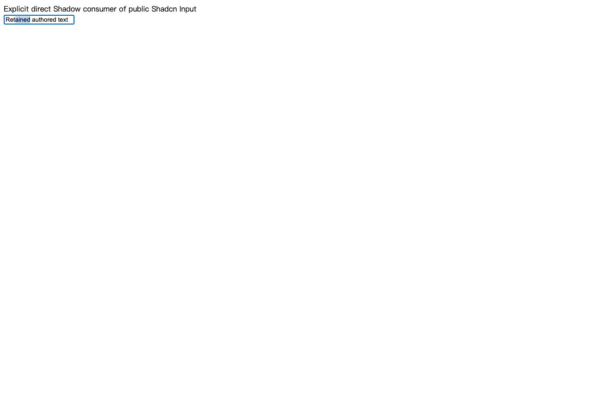

# Scope WC Focus Entry transition resampling

Agent request paraphrase: continue authorized C-group repairs with complete CodeExample content, original assertions and deadlines; preserve failures and distinguish source, installed-package, production Website and hosted acceptance.

Candidate [`6c7ef003845056873bdf8433226b33048e60fdb1`](https://github.com/HyacinthHaru/Proto-UI/commit/6c7ef003845056873bdf8433226b33048e60fdb1), tree `f22a4d52e2eb00bd154f59c5e1b7cd91d969ed9b`, parent `b6bfa4f0b978275dd2a2f0769fee19741c197459`. Two paths: WC runtime modules and seven focused regression cases. This is the existing broader S4 integration branch, not an upstream merge or a new minimal-main PR. The draft Focus Entry/Scope and Host Capability definitions retain their lifecycle.

## Measured problem and bounded repair

A native visibility transition in an unrelated region bubbles through shared HTML/BODY ancestors. Entry observers previously sampled current computed styles even when the event had no live relationship to their entry. The original full-load observation at b6 delivered a counter checkpoint8192: 8174 transitions classified outside by its preserved observation predicate; inclusive `projectCurrent` elapsed was about670.1ms. This is a delivered checkpoint, not a final event total, exclusive JS time, proven global causal attribution, or an end-to-end speedup. The emitted observation overlay and actual counters are retained in measurements.

The candidate filters only trusted transitions outside the entry's current observed, composed and Portal paths. It consults live ancestry so delegated moves and slotted regions remain eligible, including newly projected logical Portals before observation refresh. External checked-radio and image-map inputs keep broad observation; synthetic notifications retain their old path. Existing per-native-event dedup remains. Animation/toggle behavior, public API, field ownership, assertions and deadlines are unchanged. The earlier animation-duplicate hypothesis was not supported and was not adopted.

The standalone browser control changes actual CSS visibility and observes browser-generated trusted `transitionend`; it does not inject isTrusted. Root computed-style reads are counted during that single event dispatch, then settled eligibility is checked.

| Real native transition | Old installed package | Candidate installed package |
| --- | --- | --- |
| Unrelated sibling region | root style read1 (retained performance red) | read0; native child remains eligible |
| Entry descendant | read1; self fallback0 | same |
| Entry ancestor | read1; self fallback0 | same |
| Open-Shadow descendant | read1; self fallback0 | same |
| Composed slot ancestor | read1; self fallback0 | same |
| External checked radio peer | read2; no self tabindex | same |

Same final seven unit cases on b6: **1 fail / 6 pass**. Candidate focused four files: **108 pass**. Postcommit Focus/Portal expansion: **25 files / 339 pass**, maxWorkers2/minWorkers1. Emulator tests explicitly select native-bit behavior and supply HappyDOM's missing assignedSlot host fact; actual browser slot/Shadow controls are separate evidence.

## Genuine package provenance

The first comparison imported public names but inherited repository tsconfig aliases: both sides used37WCsrc/0WCdist and included the edited source, so that comparison was invalid. Original results and setup mistakes remain retained; they are not packed validation. The separate [historical evidence correction](https://github.com/HyacinthHaru/Proto-UI/commit/bdb6eb30920e2fe9d273415fab4435653e5e7401) discloses the same scope error in earlier independent Shadow fixtures. Actual production Website emitted modules were separate executions.

This packet's final controls disable tsconfig aliases. The source candidate resolves37WCsrc, with public dependency dist; the dist baseline resolves37WCdist. For the true package comparison, the existing `stagePackage` helper creates **41 local internal tarballs**, installed outside the repository with scripts disabled and no symlinked package directories. The declared external Floating UI dom is pinned1.8.0; both resulting locks use core1.8.0/dom1.8.0/utils0.2.12. This installation uses registry access, not an offline-install claim. Each native entry consumer has391input records (including the literal fixture) and37WCdist/0WCsrc. The corresponding staged runtime code differs only in WC `dist/runtime/modules.js`, plus its tarball; other artifacts and external versions are held constant. Six candidate source controls and six installed-tarball controls pass, with the baseline unrelated-read failure retained in each.

The separate public Shadcn Input fixture resolves **400 input records (including the literal fixture) /37WCdist /0WCsrc**, explicitly sets `shadow:true`, and uses the actual freshly emitted Website lease helper. Holding that installed consumer constant, the reused ca3 helper collapses range3–8 backward to0–0 forward; the emitted candidate retains3–8 backward immediately and after two frames, with field identity/focus/value intact. The helper-control bundle is explicitly reused from b6; its source blob is unchanged at6c. This is a direct physical host-move fixture, not a complete RuntimeBox family-switch journey or Shadow family-appearance acceptance. Document CSS is not imported.

Both unedited1280×900 light-preference captures were inspected. They show the same small native fixture and blue field outline; selected-range paint is not visibly discriminating here. The endpoint/direction distinction comes from actual native field state in measurements, not an inferred pixel difference. This is not a visual-design acceptance.

## Exact-head product combination and remaining failure

Node24.21.0/pnpm10.32.1/Chrome156.0.8078.79/esbuild0.25.12/macOSarm64. Signed author/committer identity, existing SSH signature, DCO and absence of coauthor checked; hook changed no candidate source/test bytes.

- Fresh **47/47 public packages**, Website **685 pages**, workspace TypeScript, and manifests complete successfully. The two disposable draft-route overlays were restored; tracked worktree is clean.
- Actual production preview Contents/Dialog/Runtime Tabs: **11 pass /13 filtered**; original1s assertions and respective deadlines retained. Trusted Header first-frame geometry passes at320/390px. Geometry measurements can force layout.
- Complete article **9/9 CodeExample** entries and **1,268 matrix roots per locale** remain. No page/resource removal.
- Nine whole-entry budgets: **3 PASS /6 ADVISORY**, retaining actual excesses under the existing phase policy. WC gzip195680/132000, over63680; growth versusb6 is103bytes. Eight other gzip/minified/hash rows unchanged. These are new local measurements, not hosted CI or strict-budget acceptance; no ceiling changed.
- Original bilingual full S4: **0 pass /2 fail**, both at original60s all-root readiness before Dialog; original150s case limits unchanged. The assertion remains `demo-shadow-split-s4.browser.test.ts:139`. StartupPending/empty-host diagnostics remain unresolved. **No full S4 pass or end-to-end performance gain is claimed.**

The initial shell tool output omitted its running handle; the original process was observed to termination without restarting it. Actual child exit receipts record build/types/manifests/budgets0 and S4exit1. No unobserved outer-shell exit is invented.

Scripts and JSON are explicitly sanitized derivatives when machine paths differ; raw/public hashes are recorded. They require reconstructed task/toolchain inputs rather than claiming standalone replay of the original machine. `candidate.patch` is the actual committed diff. Native rows, original failed assertions and source bindings are included; full retained local logs are referenced by hashes, not all claimed uploaded verbatim. PNG bytes are unchanged.

Disposition: **partial technical evidence**. Fork source is pushed; no carrier PR, formal independent approval, upstream integration, hosted run or release is asserted. Next: make the bounded WC repair independently reviewable against current main; continue the separate S4 readiness diagnosis with original deadlines and complete content. Existing PR1494 maintainer acceptance/threads remain separate.
