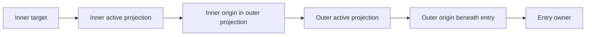

# PR1496 nested Portal ownership review response

Agent request paraphrase: continue authorized C-group repairs, verify concrete review feedback, retain actual failures, original assertions/deadlines and complete CodeExample pages; verify real source/installed artifacts before reporting acceptance.

Exact signed followup [`b68869ee223fb643fd28d841b4756633c459a33b`](https://github.com/HyacinthHaru/Proto-UI/commit/b68869ee223fb643fd28d841b4756633c459a33b), tree `bed22d8c1fc8094f1c7d1fce03286c0224c40497`, parent9427750cc760e092914087f2e88d365d115ccad9. The complete PR now has two signed commits and three changed paths versus main0f0955a9. No public API/lifecycle or compiler/IR change. C-AS-FOCUS-ENTRY-0001, C-AS-FOCUS-SCOPE-0002 and M-FOCUS-0001 remain draft; active A-WEB-COMPONENT-0001 is not expanded into an unsupported new conformance claim.

## Reproduce the actual review boundary

[Review4607386204](https://github.com/Proto-UI/Proto-UI/pull/1496#discussion_r4607386204) identified nested projections before queued observation refresh. The previous helper followed the nearest active projection to its origin, then only physical parents. With two active Portal mounts that trace reaches outer projection/body, missing the outer origin under the Entry owner, even though live scope sampling follows both markers recursively.

The helper now follows the active projection-to-origin link at each hop and crosses ShadowRoot.host as before. It tracks visited projection hops to bound logical cycles, with the set allocated only when a projection is encountered; ordinary unrelated walks allocate no set. Direct non-Portal descendants keep the helper's previous false result; the caller's existing physical/composed checks handle them. No cache, new public signal or component-name dispatch.

The same final eight-case test file with the old942helper gives **1 fail /7 pass**. Actual committed candidate: **25 files /340 pass**, maxWorkers2/minWorkers1. The new test uses actual two Portal mounts before observation refresh; the emulator's native-bit branch is explicitly disclosed. Original single-Portal, synthetic-event, moved ancestor, slot, Shadow and external-radio controls remain.

## Real native evidence and the retained negative control

The first real-UA attempt observed only end-of-transition fallback. Both old942source and installed controls passed that particular ordering: afterMount self0, later bubble/settled null. **It is not a native fallback red.** Pending observation may have refreshed the state between callbacks, but no observer callback clock or exact updater was captured. The original script/bundle bindings, complete rows and negative-control disposition remain preserved; that inference is not promoted into measured scheduling.

The discriminating host control starts a real CSS visibility transition in an unrelated staging subtree. Its earlier document capture synchronously mounts outer and inner Portals beneath the entry, then measures ownership and calls real native button.focus before returning. The original CSS event path excludes the entry. This exercises the actual private focus-history caller and its fresh recursive scope sample.

| Same native capture state | Old942source/installed | b688source/installed |
| --- | --- | --- |
| Button physically outside Entry; CSS event path lacks Entry | true | true |
| Recursive logical ownership helper | false | true |
| Native programmatic focusin | trusted, BUTTON | trusted, BUTTON |
| Current view history remembers the connected inner target | false | true |
| Later fallback and visible field | no self tabindex, visible | same |

Both source and actual installed comparisons retain the old ownership/history failures; candidate controls pass. The source native run occurred before commit with **37 tracked WC source input hashes exactly equal to the actual signed commit**. The installed run is fresh from the final candidate. These fixtures use the private Portal mount/ownership/history helpers through source or actual installed dist files; they are **internal host-contract controls**, not a public Portal export, complete Adapter user journey, trusted keyboard input or all-accessibility claim. Native isTrusted from programmatic focus does not prove user keyboard input.

The initial six public Focus Entry guard controls also run on the final source and installed packages. All six candidate modes pass on each side; the separately preserved main0f installed baseline still has unrelated root style reads2 versus candidate0. Relevant descendant/ancestor/Shadow-host-slotted/slot/external-radio behavior remains. That main0f performance baseline and the942nested-ownership baseline are distinct executions, not relabeled as each other.

## Accurate final artifacts and verification limits

Node24.21.0/pnpm10.32.1/Chrome156.0.8078.79/esbuild0.25.12/zlib1.3.2.1-motley-8002e91/macOSarm64. Builds and local browser jobs are serialized. Consumer builds disable tsconfig aliases; installed packages are not linked back to source.

- Fresh **47/47 packages**, Website **685 pages**, manifests and full types pass. Astro1240files/0errors/0warnings/31hints, retained. No generated drift; disposable draft-route overlays restored.
- Fresh **39 internal tarballs** installed outside the repository with scripts disabled; declared external dom pinned1.8.0, registry access disclosed. Private installed and public installed bundles each contain391input records including their literal fixture,37WCdist/0WCsrc. Source controls use37WCsrc. No public-import alias mistake or offline-install claim.
- Actual production Contents/Dialog/Runtime Tabs **11 pass /13 filtered**, original1s assertions and respective deadlines preserved. Trusted Header first-frame geometry at320/390 passes; geometry reads can force layout. Article9/9CodeExample and1,268matrix roots perlocale retained.
- Nine local budgets **3 PASS /6 ADVISORY**; actual values, excesses and hashes retained in measurements. No ceiling change, hosted/canonical or strict-budget acceptance claim.
- Full WC non-browser **160files:155pass/5fail,1183pass/8fail**, plus the same view-operation-receipt URLscheme loader error. The exact eight original failed assertion IDs match942 and its prior main-parent source control. No full Adapter pass. Registry/companion, animated-border admission and loader repairs remain separate C-group work; original assertions retained.
- Full original S4 last actually ran at942, with both150000ms case-deadline failures in startup-wait; source-bound main-parent control also failed. This nested-ownership-only delta has direct source/installed red-green and scoped product checks. The unchanged failing startup was **not repeated without a new readiness hypothesis**; there is no current-head full S4 pass. The historical failure is not deleted or relabeled as b688 execution.

The commit hook only wrapped a new test disposal.push line. The exact-tree publisher reported unknown because its prepared tree differed; read-only Git reconciliation confirmed the actual signed b688 commit and production bytes, and the own staged test index was synced to its already-committed final bytes. No second commit/amend/rewrite. The final formatted eight-case test file was rerun for red/green; no successful initial publisher receipt is fabricated.

## Artifacts and remaining acceptance

`review-fix.patch` is this followup; `pr-combined.patch` is all three PR paths against0f. Executed observers/builders are machine-path-sanitized derivatives with raw/public hashes and declared reconstruction inputs. Full native rows and failed assertion summaries are present; retained local logs are referenced by SHA, not all claimed uploaded verbatim. The source-bound graph/state walkthrough covers this internal ownership failure; no unrelated UI image or visual-design acceptance is manufactured.

Disposition: **partial technical evidence**. Fork/PR head readback is confirmed. Old942CI/review do not approve this new head; fresh official CI, independent maintainer review, real thread disposition and actual integration must be read live. Upstream permission remains READ; no self-approval, thread-resolution bypass, Actions rerun, secret/access change or new #848 native run.
