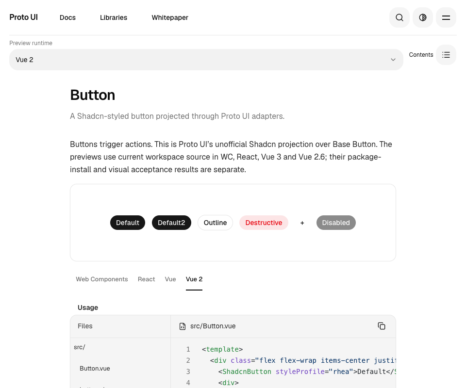
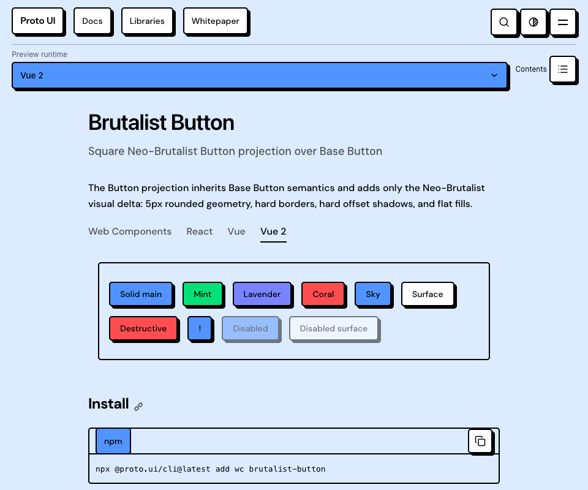

# Private Previewer Typography refresh

Exact source ae72dc6087c72f3f842536ac8067e6bd4501b94a on 534caf4a241f7f7ef49b7b073662ad982e938c91. The matched discovery fixture visits the full inventory on the parent for a private Previewer mutation. It preserves both real native-status text and outer paragraph block-eligibility changes on the candidate.

The instrumented Chinese Matrix emits 3,072 accepted observer notifications at the last delivered baseline checkpoint. Four common private Previewer container categories account for 2,349 of them. The combined candidate delivers 128 at its last trigger checkpoint and continues delivering original readiness samples beyond page second 66. Each trigger sample records the first eligible mutation in its batch. The two arms have separate clocks. Both retain 1,268 previews and fail the original 60-second readiness guard.

The exact standalone packed candidate passed six selected native cases. The four remaining Shadcn cases stopped at the unchanged Noto CJK assertion after Chrome selected PingFang SC for all nine CJK glyphs.

Shadcn Button, Vue 2, 960×800. The original document heading and code panel remain visible.

Brutalist Button, Vue 2, 960×800. The original heading, native document text and themed Button preview remain in their own scopes.
